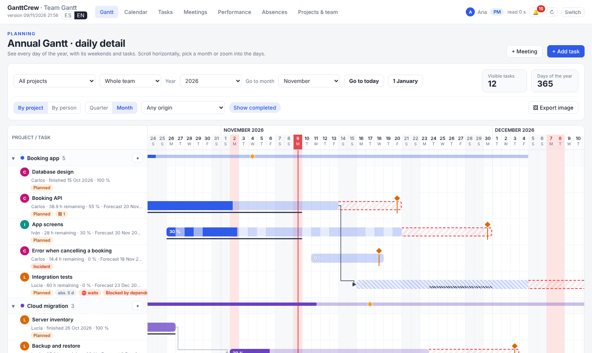
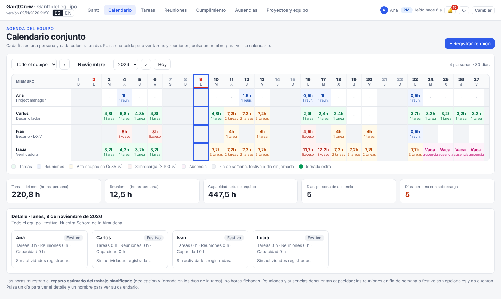

# GanttCrew

**A single-file Gantt & project planner for small teams, shared through a cloud folder.**
**Un Gantt y planificador de proyectos en un solo archivo, para equipos pequeños que comparten una carpeta en la nube.**

[English](#english) · [Español](#español) · [Live demo / Demo](https://northwalking.github.io/GanttCrew/)



---

## English

GanttCrew is a project-control tool for teams of a few people who run several projects in parallel and
do not want (or are not allowed) to install a server. The whole app is **one HTML file**. You put it in a
folder that everybody already shares — OneDrive, SharePoint, Google Drive for desktop, Dropbox or a
network drive — and each person opens it in Edge or Chrome. The data is plain JSON files in that same folder.

The interface is in **Spanish and English** (switch `ES | EN` next to the version, top-left).

### Features

- **Annual Gantt with daily detail**: every day of the year, weekends and holidays shaded, today line,
  dependencies (end → start), progress, planned vs. actual dates, and a **forecast end** (orange diamond)
  that moves when the team is overloaded. Group by project or by person; Quarter or Month zoom.
- **Forecast end dates** simulated day by day with each person's calendar: working days, holidays of
  their office, absences, meetings, other tasks (high priority first) and the dedication of each task.
- **Calendar**: team matrix (person × day) with the daily load, or one person's month.
- **People with their own schedule**: e.g. an intern on Monday, Wednesday and Friday, 4 h a day;
  **extra working days** (a Saturday, a holiday) that bring the forecast forward.
- **Meetings**: single or recurring, for the whole team or a project's participants; bulk editing;
  import from `.ics` / `.eml`; automatic import of invitations accepted in **Thunderbird**;
  export of personal and team calendars (`.ics`).
- **Absences and holidays** in three levels: national, regional and local (by office), plus personal
  absences. Includes the official calendar of the Community of Madrid (Spain) and an importer for its
  official gazette (BOCM) as an example you can adapt.
- **People change**: leave dates, handing a task over halfway, changing the PM password and handing over
  the team lead, keeping the whole history.
- **Pause, cancel and resume** tasks or whole projects, several times, with history; the end date shifts by
  the paused working days.
- **Date alerts** (🔔): tasks due in the next 5 working days, overdue, forecast to be late or ending after
  their project's deadline; projects at risk.
- **Performance** page: on-time delivery, risk, unplanned work, and — **only for the project manager** —
  a quality index per task, person and project, stored **encrypted**.
- **Private projects** for the project manager: encrypted, invisible to the team, with their own calendar.
- **Work diary**: a private, encrypted daily log for each person, with import from and download to Word.
- **Export the Gantt as an image** (PNG or clipboard) for Word or slides, with legend and scale.
- Works **offline**; no account, no server, no tracking.

### Quick start

1. Download `GanttCrew.html` from the [latest release](../../releases/latest) (or build it, see below).
2. Create a folder in your shared cloud drive, e.g. `GanttCrew/`, and inside it an empty folder `datos/`.
   Put `GanttCrew.html` next to `datos/`.
3. Share the folder with your team with **edit** permission, and make sure it is synced to each computer
   (OneDrive: right-click → *Always keep on this device*).
4. Open `GanttCrew.html` with **Microsoft Edge or Google Chrome** (desktop). Click *Choose data folder*,
   select `datos/` and allow access.
5. The first person creates the team: name and a **project manager password** (keep it safe — it encrypts
   the evaluations and private projects and cannot be recovered). Tick *Load the sample data* to explore.
6. In *Projects & team*, add people (with their email if you use Thunderbird), offices and projects.
   Everyone else just opens the same file and picks their name.

The full user guide is in [docs/guide.en.md](docs/guide.en.md); backups, people leaving and handing over
the team lead are covered step by step in [docs/handovers-and-backups.en.md](docs/handovers-and-backups.en.md).
Try it first in the [online demo](https://northwalking.github.io/GanttCrew/): it runs with the sample
company **Astrorel** and stores data only in your browser (PM password `demo-1234`).

### How it works

- **One file per person.** The project manager writes `equipo-pm.json`; each member writes
  `miembro-<id>.json`. Nobody overwrites anybody else's file, so the cloud drive never has to merge.
  The app reads all files every 20 seconds and merges them by timestamp, with ownership rules
  (tasks belong to their assignee, absences to their person, meetings to who created them).
- **Roles are enforced by the app, not by a server.** Anyone with edit access to the folder could edit the
  JSON files by hand. What *is* protected cryptographically are the quality evaluations
  (`evaluaciones-cifradas.json`) and the private projects (`privado-pm.json`): AES-GCM with a key derived
  from the PM password (PBKDF2, SHA-256).
- **Browser support**: it needs the File System Access API, available in Chromium browsers on desktop
  (Edge, Chrome). Other browsers can try the online demo, but not the shared-folder mode.

### Development

Requirements: Node.js 18 or later.

```bash
npm install                       # Prettier and Playwright (only for development)
npm run build                     # -> dist/GanttCrew.html and dist/demo/index.html
npm run serve                     # http://localhost:4173/GanttCrew.html  and  /demo/
npx playwright install chromium   # once
npm test                          # end-to-end tests
npm run format                    # code style
```

```
src/index.html      page template          src/js/00-i18n.js       language engine (ES/EN)
src/styles.css      styles                 src/js/02-sample-data.js  sample company Astrorel
src/js/*.js         app modules, concatenated in order into one <script>
i18n/en.tsv         English translations: one "Spanish<TAB>English" line per text
scripts/build.mjs   build (no dependencies)   tests/  Playwright tests   docs/  user guides
```

The app is written in Spanish; English is applied at runtime from `i18n/en.tsv`, so adding a text means
writing it in Spanish in the code and adding its translation to that file (a test fails if you forget).
More in [CONTRIBUTING.md](CONTRIBUTING.md) and [docs/architecture.md](docs/architecture.md).

### Contributing

Issues and pull requests are welcome — bugs, translations, other countries' holiday calendars, new
features. Please read [CONTRIBUTING.md](CONTRIBUTING.md) and the [Code of Conduct](CODE_OF_CONDUCT.md).
Never attach real team data to an issue.

### License

[MIT](LICENSE) © GanttCrew contributors.

---

## Español

GanttCrew es una herramienta de control de proyectos para equipos de pocas personas que llevan varios
proyectos en paralelo y no quieren (o no pueden) instalar un servidor. Toda la aplicación es **un único
archivo HTML**. Se coloca en una carpeta que todo el equipo ya comparte —OneDrive, SharePoint, Google Drive
para ordenador, Dropbox o una unidad de red— y cada persona lo abre con Edge o Chrome. Los datos son
archivos JSON en esa misma carpeta.

La interfaz está en **español e inglés** (selector `ES | EN` junto a la versión, arriba a la izquierda).

### Funciones

- **Gantt anual con detalle diario**: todos los días del año, fines de semana y festivos sombreados,
  línea de hoy, dependencias (fin → inicio), avance, fechas planificadas y reales, y **fin previsto**
  (rombo naranja) que se desplaza cuando hay sobrecarga. Agrupado por proyecto o por persona; escala
  Trimestre o Mes.
- **Fechas de fin previstas** simuladas día a día con el calendario de cada persona: días laborables,
  festivos de su centro, ausencias, reuniones, otras tareas (primero las de prioridad alta) y la
  dedicación de cada tarea.
- **Calendario**: matriz del equipo (persona × día) con la carga diaria, o el mes de una persona.
- **Personas con jornada propia**: por ejemplo un becario los lunes, miércoles y viernes, 4 h al día;
  **jornadas extra** (un sábado, un festivo) que adelantan la fecha prevista.
- **Reuniones**: puntuales o periódicas, para todo el equipo o los participantes de un proyecto;
  edición de varias a la vez; importación de `.ics` / `.eml`; registro automático de las convocatorias
  aceptadas en **Thunderbird**; exportación del calendario personal y del equipo (`.ics`).
- **Ausencias y festivos** en tres niveles: nacionales, autonómicos y locales (por centro), además de las
  ausencias personales. Incluye el calendario oficial de la Comunidad de Madrid y un importador del BOCM,
  como ejemplo adaptable a otras regiones.
- **Cambios de personas**: fechas de baja, traspaso de una tarea a medias, cambio de la contraseña de PM y
  traspaso de la dirección del equipo, conservando todo el histórico.
- **Pausar, cancelar y reanudar** tareas o proyectos completos, varias veces, con historial; el fin se
  desplaza los días laborables que ha durado la pausa.
- **Avisos de fechas** (🔔): tareas que vencen en los próximos 5 días laborables, vencidas, con retraso
  previsto o que acaban después del plazo de su proyecto; proyectos en riesgo.
- Página de **cumplimiento**: entregas a tiempo, riesgos, trabajo no planificado y —**solo para el project
  manager**— un índice de calidad por tarea, persona y proyecto, guardado **cifrado**.
- **Proyectos privados** del project manager: cifrados, invisibles para el equipo y con su propio calendario.
- **Diario de trabajo**: un registro diario privado y cifrado para cada persona, con importación y
  descarga en Word.
- **Exportar el Gantt como imagen** (PNG o portapapeles) para Word o presentaciones, con leyenda y escala.
- Funciona **sin conexión**; sin cuentas, sin servidor y sin seguimiento.

### Puesta en marcha

1. Descarga `GanttCrew.html` de la [última versión](../../releases/latest) (o genéralo, ver abajo).
2. Crea una carpeta en tu unidad compartida, por ejemplo `GanttCrew/`, y dentro una carpeta vacía `datos/`.
   Pon `GanttCrew.html` junto a `datos/`.
3. Comparte la carpeta con tu equipo con permiso de **edición** y asegúrate de que se sincroniza en cada
   ordenador (OneDrive: clic derecho → *Mantener siempre en este dispositivo*).
4. Abre `GanttCrew.html` con **Microsoft Edge o Google Chrome** (escritorio). Pulsa *Elegir carpeta de
   datos*, selecciona `datos/` y concede el permiso.
5. La primera persona crea el equipo: nombre y **contraseña de project manager** (guárdala bien: cifra las
   evaluaciones y los proyectos privados y no se puede recuperar). Marca *Cargar los datos de ejemplo*
   para explorar.
6. En *Proyectos y equipo*, añade a las personas (con su correo si usáis Thunderbird), los centros y los
   proyectos. El resto del equipo solo tiene que abrir el mismo archivo y elegir su nombre.

La guía completa está en [docs/guia.es.md](docs/guia.es.md); las copias de seguridad, las bajas y el
traspaso de la dirección del equipo se explican paso a paso en
[docs/traspasos-y-copias.es.md](docs/traspasos-y-copias.es.md).
Pruébala antes en la [demo en línea](https://northwalking.github.io/GanttCrew/): usa la empresa ficticia
**Astrorel** y guarda los datos solo en tu navegador (contraseña de PM `demo-1234`).



### Cómo funciona

- **Un archivo por persona.** El project manager escribe `equipo-pm.json` y cada miembro
  `miembro-<id>.json`. Nadie sobrescribe el archivo de otro, así que la nube nunca tiene que fusionar.
  La herramienta lee todos los archivos cada 20 segundos y los combina por fecha de modificación, con
  reglas de propiedad (las tareas son de su responsable, las ausencias de su persona, las reuniones de
  quien las creó).
- **Los permisos los aplica la propia herramienta, no un servidor.** Quien tenga permiso de edición en la
  carpeta podría modificar los JSON a mano. Lo que sí está protegido criptográficamente son las
  evaluaciones de calidad (`evaluaciones-cifradas.json`) y los proyectos privados (`privado-pm.json`):
  AES-GCM con una clave derivada de la contraseña del PM (PBKDF2, SHA-256).
- **Navegadores**: necesita la File System Access API, disponible en navegadores Chromium de escritorio
  (Edge, Chrome). Con otros navegadores se puede probar la demo, pero no el modo de carpeta compartida.

### Desarrollo

Requisitos: Node.js 18 o posterior.

```bash
npm install                       # Prettier y Playwright (solo para desarrollar)
npm run build                     # -> dist/GanttCrew.html y dist/demo/index.html
npm run serve                     # http://localhost:4173/GanttCrew.html  y  /demo/
npx playwright install chromium   # una vez
npm test                          # pruebas de extremo a extremo
npm run format                    # estilo del código
```

El código está escrito en español; el inglés se aplica al vuelo desde `i18n/en.tsv`. Para añadir un texto,
escríbelo en español en el código y añade su traducción a ese archivo (una prueba falla si se te olvida).
Más detalles en [CONTRIBUTING.md](CONTRIBUTING.md) y [docs/architecture.md](docs/architecture.md).

### Contribuir

Se agradecen incidencias y pull requests: errores, traducciones, calendarios de festivos de otros países,
nuevas funciones. Lee [CONTRIBUTING.md](CONTRIBUTING.md) y el [Código de conducta](CODE_OF_CONDUCT.md).
No adjuntes nunca datos reales de tu equipo en una incidencia.

### Licencia

[MIT](LICENSE) © GanttCrew contributors.
