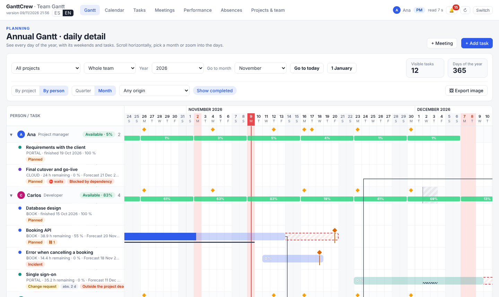
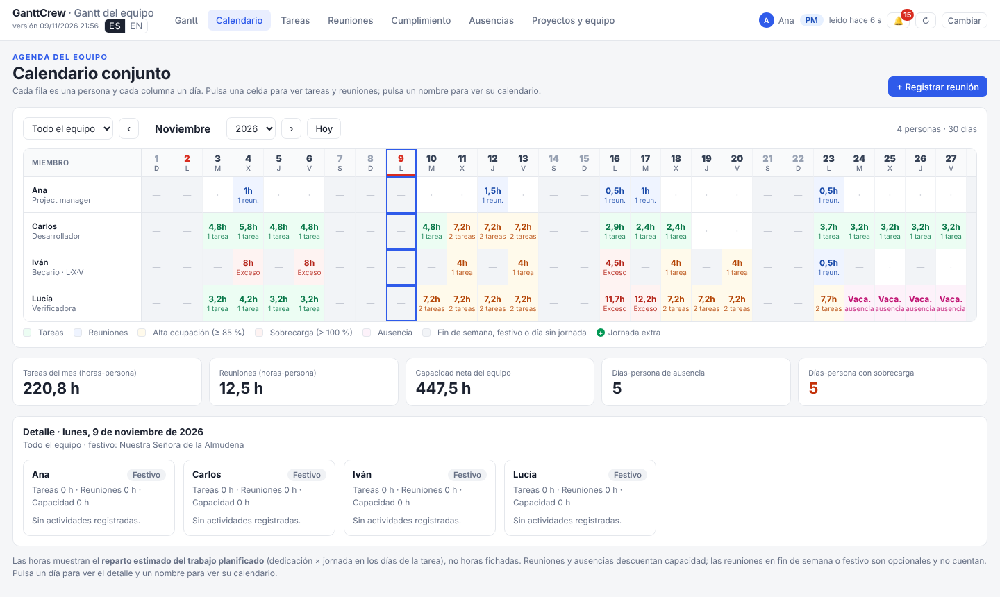

# Guía de uso de GanttCrew

[English version](guide.en.md) · [Volver al README](../README.md)

Esta guía explica cómo usar la herramienta en el día a día. Los nombres de botones y pestañas están tal
como aparecen en la interfaz en español.

## Índice

1. [Ideas básicas](#1-ideas-básicas)
2. [Puesta en marcha](#2-puesta-en-marcha)
3. [Proyectos y equipo](#3-proyectos-y-equipo)
4. [Tareas](#4-tareas)
5. [Gantt](#5-gantt)
6. [Calendario](#6-calendario)
7. [Reuniones](#7-reuniones)
8. [Ausencias, festivos y jornadas extra](#8-ausencias-festivos-y-jornadas-extra)
9. [Pausar, cancelar y reanudar](#9-pausar-cancelar-y-reanudar)
10. [Avisos de fechas](#10-avisos-de-fechas)
11. [Cumplimiento y evaluaciones](#11-cumplimiento-y-evaluaciones)
12. [Proyectos privados](#12-proyectos-privados)
13. [Exportar el Gantt como imagen](#13-exportar-el-gantt-como-imagen)
14. [Idioma](#14-idioma)
15. [Copias de seguridad y actualizaciones](#15-copias-de-seguridad-y-actualizaciones)
16. [Preguntas frecuentes](#16-preguntas-frecuentes)

## 1. Ideas básicas

- **Un archivo, una carpeta.** `GanttCrew.html` es la herramienta; la carpeta `datos/` que está a su lado
  guarda los datos. Ambos viven en una carpeta compartida y sincronizada (OneDrive, SharePoint, Google
  Drive para ordenador, Dropbox, unidad de red…).
- **Dos papeles.**
  - **Project manager (PM)**: entra con contraseña; crea proyectos y miembros, asigna tareas, edita
    cualquier tarea o ausencia, gestiona festivos y es el único que ve las evaluaciones.
  - **Miembro del equipo**: elige su nombre al entrar; ve todo el plan, crea y edita sus propias tareas y
    ausencias y registra reuniones.
- **Cada persona escribe en su propio archivo** dentro de `datos/`, así que no hay conflictos de
  sincronización. La herramienta vuelve a leer la carpeta cada 20 segundos; el botón ↻ de la cabecera
  fuerza la lectura.
- **Fecha prevista.** Además de las fechas planificadas, cada tarea tiene un **fin previsto** que la
  herramienta calcula día a día con el calendario real de su responsable. Es la base de los avisos.

## 2. Puesta en marcha

**El project manager, una vez:**

1. Crea en la unidad compartida una carpeta (por ejemplo `GanttCrew/`) con `GanttCrew.html` y una carpeta
   vacía `datos/`.
2. Comparte la carpeta con el equipo con permiso de edición y márcala para que se sincronice siempre en
   el ordenador (en OneDrive: clic derecho → *Mantener siempre en este dispositivo*).
3. Abre `GanttCrew.html` con **Edge o Chrome**, pulsa **Elegir carpeta de datos** y selecciona `datos/`.
4. Como la carpeta está vacía, aparece **Carpeta vacía: crear el equipo**: escribe tu nombre y la
   contraseña de PM (8 caracteres o más). Si marcas **Cargar los datos de ejemplo**, se crea la empresa
   ficticia Astrorel con tres proyectos, tres personas, tareas y reuniones para explorar.
   > **Guarda bien la contraseña.** Cifra las evaluaciones y los proyectos privados. Si se pierde, no se
   > pueden recuperar.
5. En **Proyectos y equipo**, revisa los centros de trabajo, añade a las personas y crea los proyectos.

**Cada miembro, una vez:** abre el enlace de la carpeta compartida, sincronízala en su ordenador, abre
`GanttCrew.html` con Edge o Chrome, elige la carpeta `datos/` y después su nombre en **¿Quién eres?**

El navegador recuerda la carpeta. Si alguna vez pide permiso otra vez, basta con pulsar **Abrir**.

## 3. Proyectos y equipo

En la pestaña **Proyectos y equipo** (solo el PM puede cambiar casi todo):

- **Proyectos** (`+ Proyecto`): nombre, **código corto** (se genera solo a partir del nombre; se puede
  cambiar), tipo, color, responsable, **participantes**, fechas de inicio y **fin objetivo**, programa u
  organismo y descripción. Los participantes sirven para las reuniones del proyecto; no hace falta que
  tengan tareas.
- **Tipos de proyecto**: lista editable (nombre, color y orden). Al renombrar un tipo se actualiza en
  todos los proyectos.
- **Equipo** (`+ Miembro`): nombre, rol, color, correo (necesario para reconocer a los asistentes de
  Thunderbird), **horas disponibles por día**, **días de trabajo** (por ejemplo, un becario: L, X, V),
  **centro de trabajo** y **fecha de incorporación** (las reuniones periódicas de todo el equipo solo le
  cuentan desde esa fecha).
- **Centros de trabajo y calendario laboral**: cada centro tiene un municipio, que decide qué festivos
  locales se aplican a las personas de ese centro.
- **Escala de calidad** y **pesos** del índice de cumplimiento (solo PM, ver §11).

## 4. Tareas

Se crean con **+ Tarea** (Gantt) o **+ Añadir tarea**, o con el botón **+** de la fila de un proyecto.

- **Origen**: *Planificada*, *Detectada en desarrollo*, *Incidencia* o *Cambio solicitado*. Las tres
  últimas cuentan como trabajo no planificado, con quién lo detectó y cuándo.
- **Prioridad**: alta, media o baja. En la previsión, las tareas de prioridad alta se atienden primero.
- **Dependencias**: la tarea no puede avanzar ni completarse hasta que terminen aquellas de las que
  depende (el PM puede permitirlo de forma excepcional). Si empieza antes de que acabe su dependencia, la
  ficha propone la fecha de inicio coherente.
- **Dedicación prevista (% de su jornada)** y **horas estimadas**: con ellas se calcula la carga y la fecha
  prevista. Si no hay horas estimadas, cuenta la dedicación durante las fechas planificadas.
- **Avance** y **horas pendientes**: si dejas las horas pendientes vacías, se calculan a partir del avance.
- **Estado**: Pendiente, En curso, Bloqueada o Completada, con fechas reales de inicio y fin.

La ficha avisa de los problemas antes de guardar:
- sobrecarga del responsable;
- ausencias durante la tarea;
- inicio o fin en un día no laborable;
- fin posterior al fin objetivo del proyecto.

Con estos avisos se puede guardar igualmente.

**¿Cómo se calcula el fin previsto?** La herramienta simula cada día laborable del responsable desde hoy:
- descuenta festivos, ausencias y reuniones;
- reparte sus horas entre sus tareas abiertas según la dedicación de cada una y la prioridad;
- tiene en cuenta las dependencias.

El día en que se agotan las horas pendientes es el fin previsto. Si cae después del fin planificado, la
tarea aparece con **retraso previsto**.

## 5. Gantt

- **Gantt anual · detalle diario**: un año completo, día a día. Usa **Año**, **Ir al mes**, **Ir a hoy** y
  **1 de enero** para moverte; el Gantt y el Calendario comparten el año y el mes.
- **Por proyecto / Por persona**: la vista por persona muestra, además, la carga semanal de cada uno
  (verde, ámbar ≥ 85 %, rojo > 100 %).
- **Trimestre / Mes**: ancho de cada día. En *Mes* se ven las etiquetas de las reuniones y se puede pulsar
  un día para abrir su detalle en el Calendario.
- **Filtros**: proyecto, persona, origen, **Mostrar completadas** y, para el PM, mostrar u ocultar los
  proyectos privados (útil al compartir pantalla).

**Cómo leer una barra:**

| Elemento | Significado |
|---|---|
| Relleno de la barra | Plan; la parte oscura es el avance |
| Línea fina bajo la barra | Fechas reales |
| Rombo naranja con línea | Fin previsto |
| Zona roja discontinua | Desde el fin planificado hasta el fin previsto (retraso) |
| Flecha | Dependencia (fin → inicio); roja discontinua = empieza antes de que acabe la anterior |
| Tramo atenuado | En pausa o cancelada desde esa fecha |

Puedes arrastrar las barras para cambiar las fechas (si tienes permiso sobre la tarea).

## 6. Calendario

- **Calendario conjunto**: cada fila es una persona y cada columna un día. Cada celda muestra las horas
  previstas y el número de tareas y reuniones, coloreadas por ocupación. Pulsa una celda para ver el
  detalle del día; pulsa un nombre para ver su calendario personal.
- **Calendario de una persona**: el mes en cuadrícula, con sus tareas, reuniones, ausencias y festivos.
- Las horas son el **reparto estimado del trabajo planificado**, no horas fichadas.

## 7. Reuniones

- **+ Reunión**: título, tipo, proyecto, fecha, hora, duración, asistentes y notas.
- **Asistentes**: elegir personas, **Todo el equipo** o **Participantes del proyecto** (si cambian los
  participantes, cambian los asistentes).
- **Reuniones periódicas**: cada día laborable, cada día, cada semana (eligiendo días), cada dos semanas o
  cada mes, con fecha final opcional. Al modificar una se elige: *Solo esta reunión*, *Esta y las
  siguientes* o *Toda la serie*. Quien se incorpore al equipo entra en las reuniones de *Todo el equipo*
  desde su fecha de incorporación.
- Las reuniones en **fin de semana o festivo** son opcionales: no cuentan en las horas, la carga ni las
  fechas previstas.
- **Seleccionar varias**: marca varias reuniones (el buscador ayuda, por ejemplo «briefing» + *Desde hoy*) y
  modifícalas a la vez: añadir o quitar asistentes, proyecto, tipo, hora o duración.
- **Importar .ics**: desde un archivo de calendario o un correo `.eml` con una convocatoria.
- **Thunderbird** (en *Proyectos y equipo*): pulsa **Crear mi archivo para Thunderbird** y sigue los pasos
  de la tarjeta. Las convocatorias que aceptes se registran solas como reuniones, también las
  periódicas. Allí mismo puedes descargar tu calendario y el del equipo en `.ics` (también para Outlook).

## 8. Ausencias, festivos y jornadas extra

En la pestaña **Ausencias**:

- **+ Ausencia**: vacaciones, ausencia con permiso, baja médica, viaje de proyecto (con disponibilidad
  parcial), congreso o formación, u otra. El resto del equipo solo ve «Ausente», sin el tipo ni la nota.
  No escribas datos médicos.
- **Festivos** en tres niveles: **nacionales** (todo el equipo), **autonómicos** y **locales** (según el
  municipio del centro de cada persona), además de los de **empresa o centro**. Los festivos no cuentan
  como días laborables.
- **Importar festivos (BOCM)**: lee el decreto anual de fiestas de la Comunidad de Madrid o la resolución
  de fiestas locales (PDF o texto pegado) y muestra lo encontrado antes de guardar. Para otras regiones,
  añade los festivos con **+ Festivo** o con **Copiar los de fecha fija a** el año siguiente.
- **+ Jornada extra**: alguien trabaja puntualmente un sábado, un domingo, un festivo o un día que no le
  toca. Esas horas cuentan en su carga y adelantan la fecha prevista de la tarea elegida (o de todas sus
  tareas en curso).

## 9. Pausar, cancelar y reanudar

En la ficha de una tarea, en **Estado**:

- **⏸ Pausar**: fecha y motivo. Mientras dure, la tarea no cuenta en la carga ni en las previsiones y no
  genera avisos. En el Gantt se sigue viendo el plan vigente, atenuado desde esa fecha.
- **✕ Cancelar**: igual, pero la tarea deja de contar en el cumplimiento.
- **▶ Reanudar** / **↻ Reactivar**: por defecto, el fin planificado se desplaza los días laborables que ha
  durado la pausa; se puede corregir. Se puede pausar y reanudar varias veces; el historial queda en la
  ficha y el Gantt dibuja la barra por tramos.

En un **proyecto** (ficha del proyecto, en **Proyectos y equipo**), pausar o cancelar aplica lo mismo a sus
tareas abiertas. Al pausar puedes desmarcar las que siguen en curso, por ejemplo las que el responsable
sigue llevando.

## 10. Avisos de fechas

La campana 🔔 de la cabecera muestra el número de avisos, en rojo si hay nuevos. Al entrar aparece un
aviso breve. Se avisa de:

- tareas que vencen en los próximos 5 días laborables, vencidas, con retraso previsto o que acaban
  después del fin objetivo de su proyecto;
- proyectos cuyo fin objetivo llega en 10 días laborables, ya ha pasado o no se cumplirá.

Cada miembro ve los avisos de sus tareas y de los proyectos de los que es responsable; el PM, los de todo el
equipo.

## 11. Cumplimiento y evaluaciones

La pestaña **Cumplimiento** resume:
- tareas completadas y entregadas a tiempo;
- tareas en riesgo, bloqueadas o esperando;
- trabajo no planificado;
- sobrecarga prevista.

**Solo el PM** ve además el **índice de calidad de cumplimiento** (0–100) por tarea, persona y proyecto.
Al completar una tarea, el PM la evalúa desde su ficha:
- calidad (1–5 ★, según la escala);
- alcance entregado (%);
- número de retrabajos.

El plazo se calcula a partir de la fecha real de fin. Los pesos de cada componente se ajustan en
*Proyectos y equipo*.

Las evaluaciones se guardan cifradas con la contraseña del PM.

## 12. Proyectos privados

El PM puede marcar un proyecto como **Privado (solo yo)**.
- Se guarda cifrado en `privado-pm.json` y el equipo no lo ve en ninguna vista, cálculo ni calendario.
- Sus tareas no cuentan en tu jornada laboral.
- Su fecha prevista se calcula con un calendario propio: las horas al día que indiques en *Proyectos y
  equipo*, todos los días.

## 13. Exportar el Gantt como imagen

**🖼 Exportar imagen** (en el Gantt): elige un proyecto (o todos), las tareas que se incluyen (por ejemplo,
una fase), el título, la escala (semanas, meses o trimestres) y si se incluye la leyenda o la cabecera.
**Copiar imagen** la deja en el portapapeles para pegarla en Word (Ctrl+V); **Descargar PNG** la guarda.
Los proyectos privados nunca se exportan.

## 14. Idioma

El selector **ES | EN** está junto a la versión, arriba a la izquierda (y en la esquina superior derecha de
las pantallas de entrada). El cambio es inmediato y cada persona elige el suyo; se recuerda en su
navegador. Se traduce la interfaz, las fechas, la imagen exportada y los calendarios `.ics`; los datos que
escribe cada usuario (nombres de proyectos, tareas, reuniones) no cambian.

## 15. Copias de seguridad y actualizaciones

- OneDrive y la mayoría de nubes guardan versiones anteriores de cada archivo.
- **Descargar copia (.json)** (PM, en *Proyectos y equipo*) guarda todo en un único archivo,
  **incluidas las evaluaciones sin cifrar**: guárdalo en un sitio privado, no en la carpeta compartida.
  **Restaurar desde copia…** lo recupera.
- **Para actualizar**, sustituye solo `GanttCrew.html`; no toques `datos/`. Pide al equipo que recargue
  la página (F5) y compruebe la versión bajo el título.

## 16. Preguntas frecuentes

**¿Puedo mover la carpeta a otro sitio?** Sí, con `datos/` dentro. Al abrir la herramienta, vuelve a
elegir la carpeta.

**¿Funciona en el móvil?** No: necesita un navegador Chromium de escritorio con acceso a carpetas.

**¿Qué pasa si dos personas cambian algo a la vez?** Cada una escribe en su propio archivo, así que no se
pisan. Si la nube crea una copia en conflicto, la herramienta la tolera.

**¿Es seguro?** Los permisos los aplica la herramienta, no un servidor. Quien tenga permiso de edición en
la carpeta podría modificar los archivos a mano. Las evaluaciones y los proyectos privados sí están
cifrados.

**El año que viene no hay festivos.** Añádelos con **Importar festivos (BOCM)**, **+ Festivo** o **Copiar
los de fecha fija a** el año nuevo. La herramienta avisa al PM si faltan.
