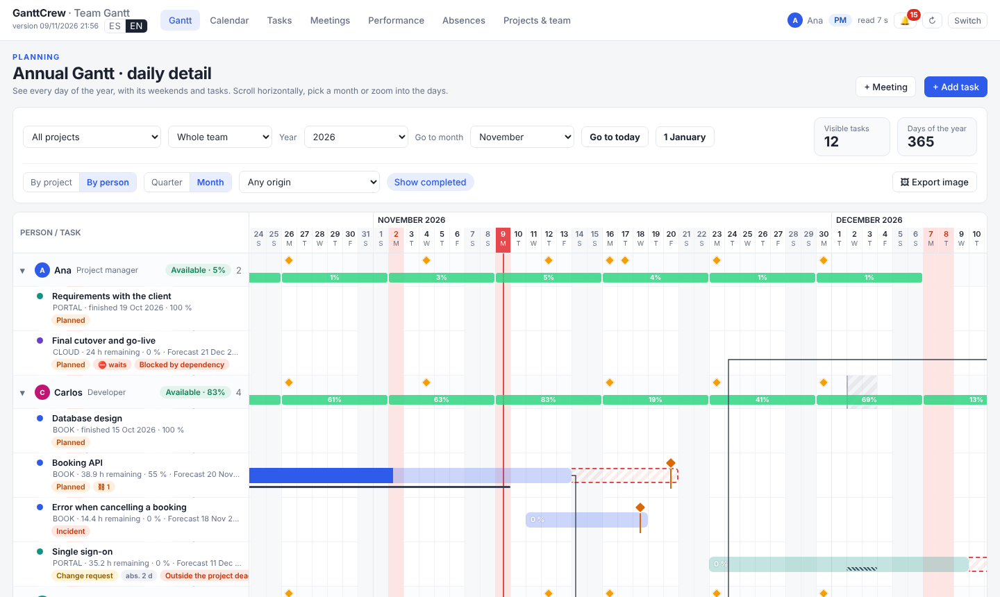
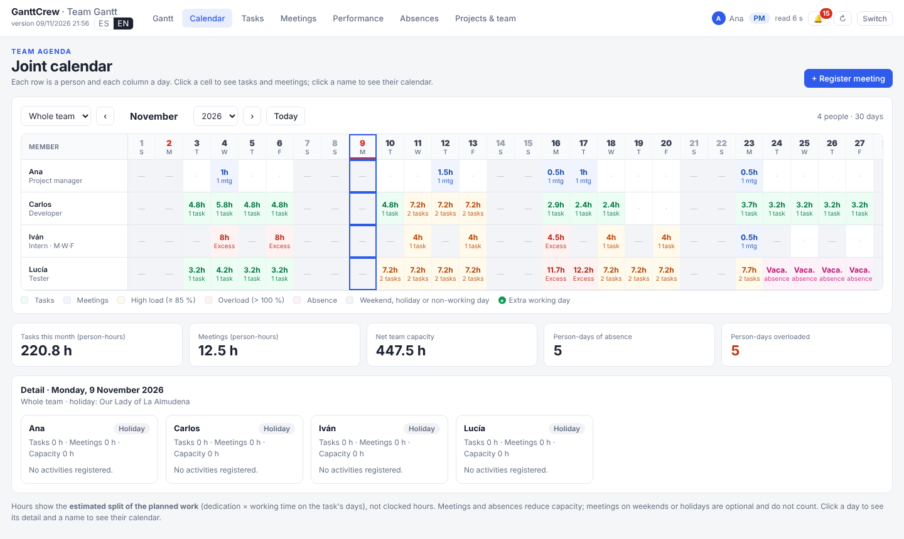

# GanttCrew user guide

[Versión en español](guia.es.md) · [Back to the README](../README.md)

This guide explains how to use the tool day to day. Button and tab names are as they appear in the English
interface.

## Contents

1. [Basic ideas](#1-basic-ideas)
2. [Getting started](#2-getting-started)
3. [Projects and team](#3-projects-and-team)
4. [Tasks](#4-tasks)
5. [Gantt](#5-gantt)
6. [Calendar](#6-calendar)
7. [Meetings](#7-meetings)
8. [Absences, holidays and extra working days](#8-absences-holidays-and-extra-working-days)
9. [Pause, cancel and resume](#9-pause-cancel-and-resume)
10. [Date alerts](#10-date-alerts)
11. [Performance and evaluations](#11-performance-and-evaluations)
12. [Private projects](#12-private-projects)
13. [Export the Gantt as an image](#13-export-the-gantt-as-an-image)
14. [Language](#14-language)
15. [Backups and updates](#15-backups-and-updates)
16. [FAQ](#16-faq)

## 1. Basic ideas

- **One file, one folder.** `GanttCrew.html` is the tool; the `datos/` folder next to it holds the data.
  Both live in a shared, synced folder (OneDrive, SharePoint, Google Drive for desktop, Dropbox, a network
  drive…).
- **Two roles.**
  - **Project manager (PM)**: signs in with a password; creates projects and members, assigns tasks, edits
    any task or absence, manages holidays and is the only one who sees the evaluations.
  - **Team member**: picks their name when entering; sees the whole plan, reports on their own tasks
    (status, progress, hours remaining, actual dates), registers their absences and meetings and keeps
    their diary. Planning (creating tasks, dates, dedication, dependencies) is changed only by the PM.
- **Everyone writes their own file** inside `datos/`, so there are no sync conflicts. The tool reads the
  folder again every 20 seconds; the ↻ button in the header forces a read.
- **Forecast date.** Besides the planned dates, each task has a **forecast end** that the tool calculates
  day by day with its owner's real calendar. Alerts are based on it.

## 2. Getting started

**The project manager, once:**

1. In the shared drive, create a folder (e.g. `GanttCrew/`) with `GanttCrew.html` and an empty `datos/`
   folder.
2. Share the folder with the team with edit permission and make sure it is always synced on the computer
   (OneDrive: right-click → *Always keep on this device*).
3. Open `GanttCrew.html` with **Edge or Chrome**, click **Choose data folder** and select `datos/`.
4. As the folder is empty, you will see **Empty folder: create the team**: enter your name and a PM password
   (8 characters or more). If you tick **Load the sample data**, the fictitious company Astrorel is
   created with three projects, three people, tasks and meetings to explore.
   > **Keep the password safe.** It encrypts the evaluations and private projects. If it is lost, they
   > cannot be recovered.
5. In **Projects & team**, check the offices, add people and create the projects.

**Each member, once:** open the shared-folder link, sync it to their computer, open `GanttCrew.html` with
Edge or Chrome, choose the `datos/` folder and then their name in **Who are you?**

The browser remembers the folder. If it ever asks for permission again, just click **Open**.

## 3. Projects and team

In the **Projects & team** tab (only the PM can change most things):

- **Projects** (`+ Project`): name, **short code** (generated from the name; can be changed), type, colour,
  owner, **participants**, start date and **target end**, programme or funding body, and description.
  Participants are used for project meetings; they do not need to have tasks.
- **Project types**: an editable list (name, colour and order). Renaming a type updates every project.
- **Team** (`+ Member`): name, role, colour, email (needed to recognise Thunderbird attendees),
  **available hours per day**, **working days** (e.g. an intern: M, W, F), **office** and **join date**
  (whole-team recurring meetings only count for them from that date).
- **Offices and working calendar**: each office has a municipality, which decides which local holidays
  apply to the people of that office.
- **Quality scale** and **weights** of the performance index (PM only, see §11).

## 4. Tasks

Create them with **+ Task** / **+ Add task** (Gantt), or with the **+** button on a project row.

- **Origin**: *Planned*, *Found during development*, *Incident* or *Change request*. The last three count
  as unplanned work, with who found it and when.
- **Priority**: high, medium or low. In the forecast, high-priority tasks are served first.
- **Dependencies**: the task cannot progress or be completed until the tasks it depends on finish (the PM
  can allow it as an exception). If it starts before its dependency ends, the form suggests a consistent
  start date.
- **Planned dedication (% of their working time)** and **estimated hours**: they drive the load and the
  forecast. Without estimated hours, the dedication over the planned dates is used.
- **Progress** and **hours remaining**: if you leave hours remaining empty, they are derived from progress.
- **Status**: To do, In progress, Blocked or Done, with actual start and end dates.

The form warns about problems before saving:
- the owner is overloaded;
- the owner has absences during the task;
- the task starts or ends on a non-working day;
- the end is later than the project's target end.

You can still save with these warnings.

**How is the forecast end calculated?** The tool simulates each of the owner's working days from today:
- it removes holidays, absences and meetings;
- it splits their hours among their open tasks by dedication and priority;
- it respects dependencies.

The day the remaining hours run out is the forecast end. If it falls after the planned end, the task shows
a **forecast delay**.

## 5. Gantt

- **Annual Gantt · daily detail**: a full year, day by day. Use **Year**, **Go to month**, **Go to today**
  and **1 January** to move around; the Gantt and the Calendar share the year and month.
- **By project / By person**: the person view also shows each person's weekly load (green, amber ≥ 85 %,
  red > 100 %).
- **Quarter / Month**: width of each day. In *Month* you see meeting labels and can click a day to open its
  detail in the Calendar.
- **Filters**: project, person, origin, **Show completed** and, for the PM, show or hide private projects
  (handy when sharing your screen).

**How to read a bar:**

| Element | Meaning |
|---|---|
| Bar fill | Plan; the dark part is progress |
| Thin line under the bar | Actual dates |
| Orange diamond with line | Forecast end |
| Dashed red area | From the planned end to the forecast end (delay) |
| Arrow | Dependency (end → start); dashed red = starts before the previous one ends |
| Dimmed section | Paused or cancelled from that date |

You can drag bars to change dates (if you have permission on the task).

## 6. Calendar

- **Joint calendar**: each row is a person and each column a day. Each cell shows the planned hours and the
  number of tasks and meetings, coloured by load. Click a cell for the day's detail; click a name for that
  person's calendar.
- **One person's calendar**: the month as a grid, with their tasks, meetings, absences and holidays.
- Hours are the **estimated split of the planned work**, not clocked hours.

## 7. Meetings

- **+ Meeting**: title, type, project, date, time, duration, attendees and notes.
- **Attendees**: choose people, **Whole team** or **Project participants** (if the participants change, the
  attendees change).
- **Recurring meetings**: every working day, every day, every week (choosing days), every two weeks or
  every month, with an optional end date. When changing one you choose: *Only this meeting*, *This and
  following ones* or *The whole series*. Anyone who joins the team enters *Whole team* meetings from their
  join date.
- Meetings on **weekends or holidays** are optional: they do not count in hours, load or forecast dates.
- **Select several**: select several meetings (the search box helps, e.g. «briefing» + *From today*) and
  change them at once: add or remove attendees, project, type, time or duration.
- **Import .ics**: from a calendar file or an `.eml` email containing an invitation.
- **Thunderbird** (in *Projects & team*): click **Create my file for Thunderbird** and follow the steps on
  the card. The invitations you accept are registered as meetings automatically, recurring ones too. The
  same card lets you download your calendar and the team's as `.ics` (also for Outlook).

## 8. Absences, holidays and extra working days

In the **Absences** tab:

- **+ Absence**: vacation, leave with permission, sick leave, project trip (with partial availability),
  conference or training, or other. It can be for **whole days** (from and to which day) or **by hours**
  (one day, from and to what time; those hours are taken off the working day). The team sees the days or
  the time range of the absence. For a **sick leave**, the rest of the team only sees «Absent», without the
  type or the note. Do not write medical details.
- **Holidays** in three levels: **national** (whole team), **regional** and **local** (by the municipality of
  each person's office), plus **company or office** holidays. Holidays do not count as working days.
- **Import holidays (BOCM)**: reads the yearly holidays decree of the Community of Madrid (Spain) or the
  local holidays resolution (PDF or pasted text) and shows what it found before saving. For other regions,
  add holidays with **+ Holiday** or use **Copy fixed-date ones to** the next year. Importers for other
  official gazettes are a welcome contribution.
- **+ Extra working day**: someone occasionally works on a Saturday, Sunday, holiday or a day they do not
  usually work. Those hours count in their load and bring forward the forecast date of the chosen task (or
  of all their tasks in progress).

## Work diary

The **Diary** tab is a personal log of what you do each day.

- **It is private.** It is stored encrypted in `datos/diario-<person>.json`. The project manager opens it
  with the PM password. Each member creates their **diary password** the first time and can tick
  *Remember in this browser* so as not to type it every time. Nobody else can read it, not even the project
  manager. **If the password is forgotten, the diary cannot be recovered.**
- **Day:** type a line and press Enter. The tool suggests the meetings and tasks you had that day, to add
  them with one click. Each line can be linked to a project.
- **Pending:** mark a line as *Pending* and follow it in the **Pending** view; *Resolve* records the date it
  was closed.
- **Formatting:** `**bold**`, `*italic*`, and sub-points with Shift+Enter and «- ». The same works in
  meeting notes and task descriptions.
- **Month** view and **search** to review your notes.
- **Import…** loads a Word (`.docx`) or text file in which each day starts with «Día 11/06/2026».
- **Download…** saves a period as Word or text. The downloaded file is not encrypted.

## Changes in the team

Summary. The step-by-step detail is in **[Handovers and backups](handovers-and-backups.en.md)**.

- **A member leaves.** In their form (*Projects & team*), set the **Leave date** (their last day). From the
  next day they are not offered in «Who are you?» or for new work, and do not count in the load or in
  recurring meetings. Their history (tasks, meetings, absences, evaluations) is kept. On saving, the tool
  lists their open tasks to hand them over; any left show as «Owner has left» in the alerts. If they come
  back, clear the date.
- **Handing over a task halfway.** In the task form, **⇄ Hand over…**: choose the other person and the last
  day of the current owner. The part done is closed under their name on that date and a linked continuation
  is created with the hours remaining. Tasks that depended on the original now depend on the continuation.
  To pass a whole task, just change its owner.
- **Recurring meetings.** To change attendees from a date on, open that day's meeting and choose *This and
  following ones*.
- **Change the PM password** (*Projects & team → Team lead*): re-encrypts the evaluations, your private
  projects and your diary.
- **Hand over the team lead.** In the same place. First you can download your **personal copy** (the team
  data and your private projects; the evaluations if you tick the box) and your diary as Word. Choose the
  new PM, who types their password, and whether you stay as a member or leave. The new PM continues with
  everything shared and the evaluations. Your private projects are removed from the folder and your diary
  is kept under a password of your own or removed. **It cannot be undone.**

## 9. Pause, cancel and resume

In a task's form, under **Status**:

- **⏸ Pause**: date and reason. While it lasts, the task does not count in load or forecasts and raises
  no alerts. The Gantt still shows the current plan, dimmed from that date.
- **✕ Cancel**: the same, but the task no longer counts in performance.
- **▶ Resume** / **↻ Reactivate**: by default the planned end shifts by the working days the pause lasted;
  you can correct it. You can pause and resume several times; the history stays in the form and the Gantt
  draws the bar in sections.

For a **project** (its form in **Projects & team**), pausing or cancelling applies to its open tasks. When
pausing you can untick the ones that continue, for example those the owner keeps working on.

## 10. Date alerts

The 🔔 bell in the header shows the number of alerts, red if there are new ones, and a short notice appears
on entering. It warns about:

- tasks due in the next 5 working days, overdue, forecast to be late or ending after their project's target
  end;
- projects whose target end is within 10 working days, already passed or will not be met.

Each member sees the alerts of their tasks and of the projects they own; the PM sees the whole team's.

## 11. Performance and evaluations

The **Performance** tab summarises:
- tasks done and delivered on time;
- tasks at risk, blocked or waiting;
- unplanned work;
- forecast overload.

**Only the PM** also sees the **delivery quality index** (0–100) per task, person and project. When a task
is done, the PM evaluates it from its form:
- quality (1–5 ★, according to the scale);
- delivered scope (%);
- number of reworks.

The deadline score comes from the actual end date. The weight of each component is set in *Projects & team*.

Evaluations are stored encrypted with the PM password.

## 12. Private projects

The PM can mark a project as **Private (only me)**.
- It is stored encrypted in `privado-pm.json`, and the team does not see it in any view, calculation or
  calendar.
- Its tasks do not count in your working time.
- Its forecast date uses its own calendar: the hours per day you set in *Projects & team*, every day.

## 13. Export the Gantt as an image

**🖼 Export image** (in the Gantt): choose a project (or all), the tasks to include (e.g. one phase), the
title, the scale (weeks, months or quarters) and whether to include the legend or the header. **Copy
image** puts it on the clipboard to paste into Word (Ctrl+V); **Download PNG** saves it. Private projects
are never exported.

## 14. Language

The **ES | EN** switch is next to the version, top-left (and top-right on the start screens). The change is
immediate and each person chooses their own; it is remembered in their browser. The interface, dates, the
exported image and the `.ics` calendars are translated; what users type (names of projects, tasks,
meetings) is not.

## 15. Backups and updates

- OneDrive and most cloud drives keep previous versions of each file.
- **Download backup (.json)** (PM, in *Projects & team*) saves everything in one file, **including the
  evaluations unencrypted**: keep it somewhere private, not in the shared folder. **Restore from backup…**
  brings it back.
- **To update**, replace only `GanttCrew.html`; do not touch `datos/`. Ask the team to reload (F5) and check
  the version under the title.

## 16. FAQ

**Can I move the folder?** Yes, with `datos/` inside. When you open the tool, choose the folder again.

**Does it work on a phone?** No: it needs a desktop Chromium browser with folder access.

**What if two people change something at the same time?** Each writes their own file, so they do not
overwrite each other. If the cloud drive creates a conflict copy, the tool tolerates it.

**Is it secure?** Permissions are enforced by the tool, not by a server. Anyone with edit access to the
folder could modify the files by hand. Evaluations and private projects are encrypted.

**There are no holidays for next year.** Add them with **Import holidays (BOCM)**, **+ Holiday** or **Copy
fixed-date ones to** the new year. The tool warns the PM when they are missing.
