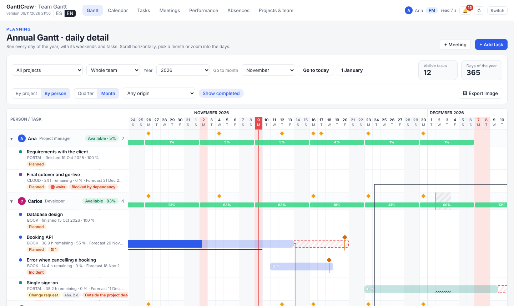
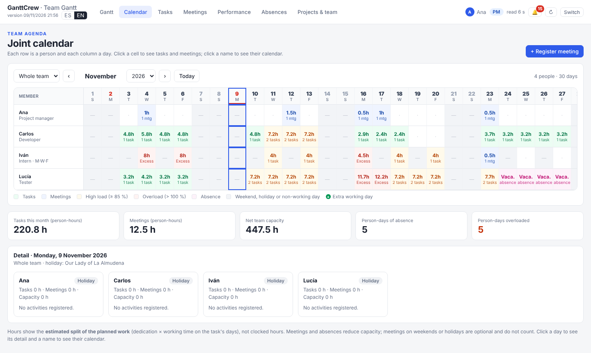

# GanttCrew user manual

**Author:** Schon LIANG

[Versión en español](manual.es.md)

This manual covers **version 1.4.0** of the tool. It is the same document in the GitHub repository and in
the package installed in the shared folder (there, as `USER MANUAL.html`).

Button and tab names are as they appear in the English interface. The tool file is called
`GanttCrew.html`; your organisation may have given it another name. It works the same.

## Contents

**Part I · Getting started**

1. [What it is and how it works](#what-it-is-and-how-it-works)
2. [Setting up](#setting-up)
3. [Installing a new version](#installing-a-new-version)
4. [Language](#language)

**Part II · Day to day**

5. [Projects and team](#projects-and-team)
6. [Tasks](#tasks)
7. [Gantt](#gantt)
8. [Calendar](#calendar)
9. [Meetings](#meetings)
10. [Absences, holidays and extra working days](#absences-holidays-and-extra-working-days)
11. [Pause, cancel and resume](#pause-cancel-and-resume)
12. [Alerts](#alerts)
13. [Work diary](#work-diary)
14. [Performance and evaluations](#performance-and-evaluations)
15. [Private projects](#private-projects)
16. [Export: image and Excel](#export-image-and-excel)

**Part III · Data, backups and handovers**

17. [Where the data is](#where-the-data-is)
18. [Backups](#backups)
19. [Passwords and recovery code](#passwords-and-recovery-code)
20. [A member leaves the team](#a-member-leaves-the-team)
21. [Handing a task over to someone else](#handing-a-task-over-to-someone-else)
22. [Recurring meetings when a person changes](#recurring-meetings-when-a-person-changes)
23. [Handing the team lead over to another PM](#handing-the-team-lead-over-to-another-pm)
24. [Summary: which backup for each case](#summary-which-backup-for-each-case)

**Part IV · More information**

25. [FAQ](#faq)
26. [Version history](#version-history)

---

# Part I · Getting started

## What it is and how it works

GanttCrew is a planning and project-control tool for small teams. It is **a single HTML file** opened in the
browser; it needs no server, installation or accounts.

- **One file and one folder.** The tool file and, next to it, the `datos` folder where everything is
  stored. Both live in a shared, synced folder (OneDrive, SharePoint, Google Drive for desktop, Dropbox, a
  network drive…).
- **Browser:** desktop Microsoft **Edge** or Google **Chrome**. Firefox, Safari and phones do not work,
  because they do not let a page work with a folder on the computer.
- **Two roles.**
  - **Project manager (PM)**: signs in with a password. The only one who plans: creates projects, tasks
    and members, assigns, changes dates, dedication and dependencies, manages holidays and sees the
    evaluations.
  - **Team member**: picks their name on entering, without a password. Sees the whole plan, reports on
    their own tasks (status, progress, hours remaining, actual dates and block reason), registers their
    absences and meetings and keeps their diary.
- **Everyone writes their own file** inside `datos`, so syncing creates no conflicts. The tool reads the
  folder again every 20 seconds; the **↻** button in the header forces it. **Switch user**, in the header,
  lets you enter with another name.
- **Forecast date.** Besides the planned dates, each task has a **forecast end** the tool calculates day by
  day with its owner's real calendar. Alerts are based on it.
- **Version.** The build date and time (Madrid time) appear under the title, on the start screen and in
  *Projects & team → Tool version*. If two people see different versions, someone has an old file.
- **About.** The **ℹ** button next to the version, or the link in the footer, opens the **About GanttCrew**
  window: version number, authorship, licence (MIT) and a link to the source code.

## Setting up

### The project manager, once

1. In the shared drive, copy a folder (for example «Team Gantt») with the tool file, this manual and an
   empty `datos` folder.
2. Share the folder with the team with edit permission. In OneDrive: right-click → **Share** → add the
   people with «Can edit».
3. Keep the folder always on your computer. In OneDrive: right-click → **Always keep on this device**.
4. Open the tool file with **Edge or Chrome** (right-click → *Open with*).
5. Click **Choose data folder**, select the `datos` folder and accept the permission.
6. As the folder is empty, you see **Empty folder: create the team**: enter your name and the PM password
   (8 characters or more).
   - If you tick **Load the sample data**, the fictitious company Astrorel is created with three projects,
     three people, tasks and meetings to explore. Untick it to start from scratch.
   - Right after, a **recovery code** appears. Keep it outside the shared folder: if you forget the
     password, it lets you set a new one (see [Passwords and recovery code](#passwords-and-recovery-code)).
7. In **Projects & team**, check the offices (each site's municipality), add people with their office,
   working time and email, and create the projects.

### Each member, once

1. Open the folder link received from OneDrive and click **Add shortcut to My files**, so it syncs to their
   computer.
2. In File Explorer: right-click the folder → **Always keep on this device**.
3. Open the tool file with Edge or Chrome, click **Choose data folder**, choose `datos` and then their name in
   **Who are you?**

The browser remembers the folder. If it ever asks for permission again, just click **Open**.

## Installing a new version

1. **First**, the PM makes a full backup: *Projects & team → Backup → Download backup (.json)* (see
   [Backups](#backups)).
2. Replace **only** the tool file (and this manual). **Do not touch the `datos` folder.**
3. Ask the whole team to reload the page (F5) and check the version under the title.
4. When the [version history](#version-history) says «whole team at once», nobody should keep using the
   previous version: older versions do not understand some new data.

When a new version opens, the tool shows **what's new**. No data is lost.

## Language

The **ES | EN** switch is next to the version, top-left, and top-right on the start screens. The change is
immediate; each person chooses their own and it is remembered in their browser. The interface, dates, the
exported image, the Excel workbook and the `.ics` calendars are translated. What people type (names of
projects, tasks, meetings) is not.

---

# Part II · Day to day

## Projects and team

In the **Projects & team** tab (the PM changes almost everything):

- **Projects** (**+ Project**): name, **short code** (generated from the name; ↻ regenerates it and it can be
  typed), type, colour, owner, **participants**, start date and **target end**, programme or funding body,
  and description. Participants are used for project meetings; they do not need to have tasks.
- **Project status**: active, paused, **Closed (finished)** or **Cancelled** (with date and reason). See
  [Pause, cancel and resume](#pause-cancel-and-resume).
- **Project types**: an editable list (name, colour and order). Renaming a type updates every project.
- **Team** (**+ Member**): name, role, colour, **email** (used to recognise them in imported invitations),
  **available hours per day**, **working days** (for example an intern: M, W and F at 4 h), **office**,
  **join date** (whole-team recurring meetings only count for them from that date) and **leave date**.
- **Offices and working calendar**: each office has a municipality, which decides which local holidays apply
  to its people.
- **Quality scale** and **weights** of the performance index (see [Performance and
  evaluations](#performance-and-evaluations)).
- **Team lead 🔒** (PM): change the password, create the recovery code and hand over the team lead.
- **Backup 🔒** (PM), **Thunderbird** and **Tool version**.

## Tasks

The PM creates them with **+ Task** (Gantt) or the **+** button on a project row.

- **Origin**: *Planned*, *Found during development*, *Incident* or *Change request*. The last three count as
  unplanned work, with who found it and when.
- **Priority**: high, medium or low. In the forecast, high-priority tasks are served first.
- **Dependencies**: the task cannot progress or be completed until the tasks it depends on finish (the PM
  can allow it as an exception). If it starts before its dependency ends, the form suggests a consistent
  start date.
- **Planned dedication (% of their working time)** and **estimated hours**: they drive the load and the
  forecast. Without estimated hours, the dedication over the planned dates is used.
- **Collaborators**: other people helping the owner, each with their own dedication (% of their working
  time). Their hours count in their load and in the overload warning, and bring the forecast date forward.
  They see the task in their Gantt, their calendar and their list (when filtering by their name) and get an
  alert in the bell when added. In the task list they show as «+1», «+2»… next to the owner. Progress is
  still reported by the owner. Their help counts until the task finishes. Note: if the task has **no
  estimated hours**, its size is the sum of what everyone contributes, so adding a collaborator without
  lowering the owner's dedication makes it bigger, not shorter. For the help to bring it forward, set the
  estimated hours or lower the owner's dedication.
- **Progress** and **hours remaining**: if you leave hours remaining empty, they are derived from progress.
- **Status**: To do, In progress, Blocked (with a reason) or Done.
- **Actual start and end dates**: when the status changes to «in progress» or «done», the tool proposes
  today's date. They can be left blank, also in a finished task (for example, if the plan was met or the
  date is not remembered). A finished task without an actual end is drawn up to its planned end and does not
  count in punctuality.
- **Description** with formatting: `**bold**`, `*italic*`, lists with «- » or «1. » and links.

**Members** only update their own tasks (status, progress, hours remaining, actual dates and block reason).
They see other people's tasks as «Task (read only)». If a date is still uncertain, the PM sets a reasonable
provisional one and says so in the description.

**Warnings in the form before saving** (you can still save):

- the owner or a collaborator is overloaded or at the limit;
- absences during the task;
- start or end on a non-working day;
- end later than the project's target end.

**How the forecast end is calculated.** The tool simulates each of the owner's working days from today: it
removes holidays, absences and meetings, splits their hours among their open tasks by priority and
dedication, adds the collaborators' help and respects dependencies. The day the remaining hours run out is
the forecast end. If it falls after the planned end, the task shows a **forecast delay**. The full formulas,
with an example, are in [Workload and forecast
date](https://github.com/Northwalking/GanttCrew/blob/main/docs/workload-and-forecast.en.md).

## Gantt

- **Annual Gantt · daily detail**: a full year, day by day. **Year**, **Go to month**, **Go to today** and
  **1 January** move around. The Gantt and the Calendar share the year and month.
- **By project / By person**: the person view shows each person's weekly load (green; amber from 85 %; red
  above 100 %), their absences and meetings, and a load table for the coming weeks.
- **Quarter / Month**: width of each day. In *Month* you can click a day in the header to open its detail in
  the Calendar.
- **Filters**: project, person, origin, **Show completed** and, for the PM, **🔒 Private** (shows or hides
  them; handy when sharing your screen).

**How to read a bar**

| Element | Meaning |
|---|---|
| Bar fill | Plan; the dark part is progress |
| Thin line under the bar | Actual dates |
| Orange diamond with line | Forecast end |
| Dashed red area | From the planned end to the forecast end (delay) |
| Arrow | Dependency (end → start); dashed red = starts before the previous one ends |
| Dimmed section | Paused or cancelled from that date |
| Dotted section | Period when it was paused |
| «⇄ part 1» / «⇄ continuation» | Task handed over to someone else |
| «Outside the project deadline» | Ends or is forecast after the project's target end |

**Meetings in the Gantt.** Each meeting is an orange diamond on its day. When a day has **several**, a single
darker diamond shows the number of meetings; hovering lists them all with their times and clicking opens the
list to open any of them.

The PM can drag bars to change dates.

## Calendar

- **Joint calendar**: each row is a person and each column a day. Each cell shows the planned hours and the
  number of tasks and meetings, coloured by load; also absences, holidays and extra working days. Click a
  cell for the day's detail and a name for that person's calendar.
- **One person's calendar**: the month as a grid, with their tasks, meetings, absences and holidays.
- Hours are the **estimated split of the planned work**, not clocked hours.

## Meetings

- **+ Meeting**: title, type, project, date, **start and end time** (as in Outlook; moving the start moves
  the end with it), attendees and notes (with formatting).
- **Privacy**: the title, type, project and notes are only seen by the attendees and whoever created it.
  Everyone else, the PM included, only sees that those people are **in a meeting** (day, time and who),
  with 🔒. The meeting still takes working hours and counts in the forecast dates.
- **Who manages it**: whoever created it; the PM also manages the ones they attend.
- **Attendees**: chosen people, **Whole team** or **Project participants** (if the participants change, the
  attendees change). When filtering by attendee, the title shows how many match («attended by Lucía: 5 of 6»).
- **Recurring meetings** (**Repeat**): every working day, every day (weekends too), every week or every two
  weeks (choosing the days, for example Tuesday and Thursday) or every month, with an optional **To** date.
  «Do not place it on whole-team holidays» is ticked by default. When changing or deleting one you choose
  *Only this meeting*, *This and following ones* or *The whole series*. Anyone who joins enters *Whole team*
  meetings from their join date.
- **Weekends or holidays**: those meetings are optional («weekend · optional») and do not count in hours,
  load or forecast dates.
- **Select several**: select meetings by clicking them, or filter and click **Select the N**. To filter,
  type **just one word of the title** in the search box (for example, briefing) and choose the period in the
  drop-down (for example, *From today (all future ones)*). Then **Modify the selected ones** (add or remove
  attendees, project, type, time and duration) or **Delete the selected ones**.
- **Import .ics**: from an `.ics` calendar file or an `.eml` email containing an invitation (Outlook and
  others). Attendees are recognised by their email; without an email, only if the name matches exactly.

### Thunderbird

Set up in *Projects & team*, **Thunderbird** card.

- **Invitations → tool.** Click **Create my file for Thunderbird**: it creates
  `datos/thunderbird-<your-name>.ics`. In Thunderbird: Alt → **File → Open → Calendar File…** → that file,
  **without** ticking read-only. In its properties, under «Email», choose the account where you receive the
  invitations. Invitations you accept are registered as meetings automatically, recurring ones too.
- **Plan → Thunderbird.** `datos/calendario-<your-name>.ics` (and `calendario-equipo.ics`) open the same way,
  but **read-only**. Do not mix up the two files. They also work for Outlook.
- **Hide the whole series**: in an imported recurring invitation, removes all its meetings from the tool,
  future ones too, without touching Thunderbird. Show it again from the Thunderbird card. Deleting them does
  not help: they would come back at the next sync.

## Absences, holidays and extra working days

In the **Absences** tab:

- **+ Absence**: vacation, leave with permission, sick leave, project trip (with partial availability, 50 %
  by default), conference or training, or other.
  - **Whole days** (from and to which day) or **By hours** (one day, from and to what time): those hours are
    taken off the working day.
  - The team sees the days or the time range of the absence. For a **sick leave**, the rest only see
    «Absent», without the type or the note. Do not write medical details.
- **Holidays** in three levels: **national** (whole team), **regional** and **local** (by the municipality of
  each person's office), plus **company or office** holidays. They do not count as working days.
- **Holidays for the following years.** **Import holidays (BOCM)**: upload the PDF of the regional holidays
  decree (published at the end of September) or of the local holidays resolution (December), or paste its
  text; the tool shows what it found before saving. If the format changes and not every date is recognised,
  or for other regions, add them with **+ Holiday** or **Copy fixed-date ones to** the next year. An orange
  notice in *Absences* shows what is missing.
- **+ Extra working day**: someone occasionally works on a Saturday, Sunday, holiday or a day they do not
  usually work, with hours and an optional task. Those hours count in their load and bring forward the
  forecast date of the chosen task (or of all their tasks in progress).

## Pause, cancel and resume

In a task's form, **Status** section (PM):

- **⏸ Pause**: date and reason. While it lasts, the task does not count in load or forecasts and raises no
  alerts. The Gantt shows the current plan dimmed from that date.
- **✕ Cancel**: the same, and it also stops counting in performance.
- **▶ Resume** / **↻ Reactivate**: by default the planned end shifts by the working days the pause lasted;
  you can correct it. You can pause and resume several times; the history stays in the form and the Gantt
  draws the bar in sections.

For a **project** (its form in *Projects & team*), pausing, cancelling, resuming or reactivating applies the
change to its open tasks. When pausing you can untick the ones that continue; when resuming, a table proposes
each task's new end, editable.

## Alerts

The 🔔 bell in the header shows the number of alerts, red if there are new ones. A short notice appears on
entering.

- **Dates**: tasks due in the next 5 working days, overdue, forecast to be late or ending after their
  project's target end; projects whose target end is within 10 working days, already passed or will not be
  met.
- **Assignments** (for 14 days): «New task assigned to you», «Reassigned to you (previously owned by…)»,
  «No longer yours: now owned by…» and «You collaborate on this task».
- **Owner has left**: open tasks of someone who has already left the team.

Each member sees those of their tasks and of the projects they own; the PM sees the whole team's. The tool
**sends no emails**: it has no server, so alerts only appear inside it.

## Work diary

The **Diary** tab is a personal log of what you do each day. It is only a log: it does not count hours.

- **It is private and encrypted** (`datos/diario-<person>.json`). The PM opens it with the PM password. Each
  member creates their **diary password** the first time and receives a **recovery code**. Nobody else can
  read it, not even the PM. *Remember in this browser* saves typing it every time (do not tick it on a
  shared computer).
- **Day**: type a line and press Enter. The tool suggests the meetings and tasks you had that day, to add
  them with one click. Each line can be linked to a project.
- **Pending**: mark a line as *Pending* and follow it in the **Pending** view; *Resolve* records the date it
  was closed.
- **Formatting**: `**bold**`, `*italic*`, sub-points with Shift+Enter and «- », and links.
- **Month** view and **search** to review your notes.
- **Import…**: a Word (`.docx`) or text file in which each day starts with «Día 11/06/2026».
- **Download…**: a period, or everything, as Word or text. The downloaded file is **not encrypted**.
- **🔑**: create a new recovery code (the previous one stops working).

## Performance and evaluations

The **Performance** tab summarises tasks done and delivered on time, tasks at risk, blocked or waiting,
unplanned work and forecast overload.

**Only the PM** sees the **delivery quality index** (0–100) per task, person and project. When a task is
done, the PM evaluates it in its form: quality (1–5 ★, according to the scale), delivered scope (%) and
number of reworks. The deadline score comes from the actual end date. To remove an evaluation, click the
selected star again or **Remove evaluation**, and save. Weights are set in *Projects & team*.

Evaluations are stored encrypted with the PM password.

## Private projects

The PM can mark a project as **Private (only me)**, to use it as a personal agenda:

- it is stored encrypted in `privado-pm.json` and the team does not see it in any view, calculation or
  calendar;
- its tasks do not count in your working time;
- its forecast date uses its own calendar: the hours per day you set in *Projects & team* (2 h by
  default), every day;
- the **🔒 Private** button in the Gantt shows or hides them on your screen.

The backup (`.json`) includes them **unencrypted**: keep it somewhere private.

## Export: image and Excel

**🖼 Export image** (in the Gantt): the same diagram as the tool, to paste into Word. Choose a project (or
all), the tasks (for example, one phase), the period, the title, the scale (days, weeks, months or quarters)
and whether to include the legend and the header. **Copy image** puts it on the clipboard (Ctrl+V in Word);
**Download PNG** saves it.

**Export to Excel** (in the Gantt): an `.xlsx` workbook for people who do not use the tool. Choose project,
period, scale (weeks or days) and whether to include completed tasks.

- **Gantt** sheet: one row per task with owner (and collaborators), dates, progress and status, and one cell
  per week or day in each person's colour (dark = progress, light = remaining, pink = forecast delay, grey =
  paused or cancelled; orange in the header = today).
- **Tasks** sheet: the same tasks as a filterable table.

It is a snapshot: if the plan changes, export again. Private projects, evaluations and diaries are **never
exported**.

The image and the Excel workbook carry a discreet line at the bottom, «Generated with GanttCrew …», with the
version and the authorship. The files the tool generates (Excel, diary Word files and `.ics` calendars) also
state in their properties the program that created them; the document author is the person who exports it.

---

# Part III · Data, backups and handovers

This part explains, step by step, how to back up the data and how to handle changes of people without losing
the history. Read it all before handing over the team lead: it is the only operation that **cannot be
undone**.

## Where the data is

Everything is in the `datos` folder, next to the tool file:

| File | Contents | Written by | Encrypted |
|---|---|---|---|
| `equipo-pm.json` | Projects, team, settings, holidays and what the PM records | The PM | No |
| `miembro-<id>.json` | What each member records: progress of their tasks, absences, meetings | Each member | No |
| `evaluaciones-cifradas.json` | Quality evaluations | The PM | Yes, with the PM password |
| `privado-pm.json` | The PM's private projects | The PM | Yes, with the PM password |
| `diario-<id>.json` | Each person's work diary | Each person | Yes, with their own key |
| `thunderbird-<name>.ics` | Invitations accepted in Thunderbird | Thunderbird | No |
| `calendario-….ics` | Calendars to subscribe to | The tool | No |

- Each person writes their own file, so OneDrive creates no conflicts. The tool merges them all when
  reading. If a `…-PCNAME.json` file appears (an OneDrive conflict copy), nothing happens.
- **The rules on who edits what are enforced by the tool.** Someone with edit access to the folder could
  change the files by hand. Encrypted data (evaluations, private projects and diaries) is protected.
- **Meeting privacy is enforced by the tool, not by the files**: meeting data is not encrypted.
- **Encrypted data depends on a password nobody can reset**, except with its **recovery code**. Without
  password or code, losing the PM password loses the evaluations, the private projects and the PM's diary;
  forgetting a diary password loses that diary.
- **The PM's diary** is encrypted with the PM password; each member's, with their diary password.

## Backups

There are several ways to back up. They complement each other; use at least the first two.

### Full backup from the tool (PM)

The main backup. It saves everything the team manages in a single file.

1. Sign in as PM.
2. Go to **Projects & team** and scroll down to **Backup 🔒**.
3. Click **Download backup (.json)**. `copia-gantt-YYYY-MM-DD.json` is downloaded.
4. Move it somewhere **private and outside the shared folder** (your personal OneDrive, an external disk).

**Included:** projects, tasks, team, meetings, absences, holidays, extra working days, settings, your private
projects and **the evaluations unencrypted**. **Not included:** the diaries and the Thunderbird files.

**When to do it:** once a week or after a long planning session; **before installing a new version**;
**before handing over the team lead** and right after (by the new PM); before deleting a project or
restoring another backup.

> As it carries the evaluations unencrypted, treat this file as confidential.

### Copy of the whole `datos` folder

The most complete copy: it also includes the diaries (encrypted) and the Thunderbird files.

1. Ask the team not to edit for a minute and wait until OneDrive finishes syncing (green tick).
2. Copy the whole `datos` folder somewhere private, with the date in its name (for example
   `datos 2026-11-13`).

To recover it, replace the `datos` folder with the copy. Encrypted files still need the passwords in use **on
the day of the copy**.

### OneDrive version history

To recover **one specific file** if it got damaged or deleted.

1. In OneDrive (web) or File Explorer, right-click the file, for example `equipo-pm.json`.
2. Choose **Version history** and restore the version from the day you need.
3. In the tool, click ↻ to read the folder again.

### Each person's diary

Everyone keeps their own; nobody else can do it for them.

1. **Diary** tab → **Download…**
2. Choose the period (**The whole diary** for a full copy) and the format **Word (.docx)** or **Text**.
3. Click **Download**. The file is **not encrypted**: keep it somewhere private.

To load it back: **Diary → Import…** and choose that file. Identical notes are not duplicated.

### Restoring a `.json` backup into the team

1. Sign in as PM and first back up the current state, just in case.
2. **Projects & team → Backup → Restore from backup…** and choose the file.
3. Check the Gantt and ask the team to reload the page (F5).

The items in the backup go back to how they were on that day, **even if someone changed them afterwards**.
Anything created after the backup is kept. Evaluations and private projects from the backup are re-encrypted
with your current password.

### Viewing a backup in a separate folder (personal copy)

To keep and view your history without touching the team data, for example after leaving the team lead.

1. Create a new folder **of your own** with the tool file and an empty `datos` folder.
2. Open the tool with Edge or Chrome and choose that `datos` folder.
3. In **Empty folder: create the team**, enter your name and a new password, and **untick** «Load the sample
   data».
4. **Projects & team → Backup → Restore from backup…** and choose your `.json` backup.
5. You will have the Gantt, the calendar, the tasks and your private projects as they were that day (and the
   evaluations, if the backup carried them).
6. For your diary: **Diary → Import…** and choose the Word file you downloaded.

## Passwords and recovery code

Members have no password to enter; only their diary one. The only access password is the PM's.

### Changing the project manager password

1. Check OneDrive is synced and no other window of the tool is open as PM.
2. **Projects & team → Team lead 🔒 → Change the password…**
3. Type the current one and the new one twice (8 characters or more). Click **Change**.
4. Wait for «Password changed».

The evaluations, your private projects and your diary are re-encrypted with the new one; members notice
nothing. At the end you receive a **new recovery code** (the previous one stops working).

### If you forget a password: the recovery code

When the PM password is created (with the team or when it is changed) and when a diary password is created,
the tool shows **only once** a 20-character code, for example `7KQ2M-X9D4T-…`. It is not stored anywhere:
keep it yourself outside the shared folder (password manager, paper in a drawer or a personal file). It can
be copied or downloaded as `.txt`. With it you set a new password without losing anything.

- **PM:** in «Who are you?», choose your name, click **Forgotten your password?**, type the code and the new
  password twice. You enter as PM and receive a new code.
- **A member's diary:** in **Diary**, click **Forgotten your password?**, type the code and the new password.
  Only the owner sees the diary code; the PM's code does not open other people's diaries.
- **Creating a new code**: the PM, in **Team lead 🔒**, which also shows whether there is one; each member,
  with the 🔑 button in their diary. Teams and diaries created before version 1.2.0 have no code: create it as
  soon as possible.
- **Careful:** whoever has the PM code can take over the PM role; whoever has a diary code can read it. If you
  think someone has seen it, create a new one.

## A member leaves the team

**Before their last day**

1. Ask them to download their diary if they want to keep it. Nobody else can open it.
2. Go through their open tasks with them and the actual progress of each.

**The PM records the leave**

3. **Projects & team →** click their name under **Team**.
4. In **Leave date**, set their **last day in the team** and click **Save**.
5. Their **Open tasks** list opens. For each one, click **Hand over…** (see [Handing a task
   over](#handing-a-task-over-to-someone-else)). You can come back later: tasks not handed over show in the
   🔔 bell as «Owner has left».

**What changes from the day after the leave date**

- They are not offered in «Who are you?» or in the lists to assign tasks, absences or meetings.
- They do not count in the load or the forecast dates, and leave the later recurring meetings.
- Their history is kept under their name: finished tasks, meetings, absences and evaluations.

**Afterwards**

6. If they were a participant of ongoing projects, remove them from each project's form if they should no
   longer appear.
7. Their `diario-<id>.json` can be deleted from `datos` once no longer needed.
8. Remove their access to the shared folder.

**If they come back:** clear the leave date in their form and everything returns.

> Do not remove the member with **Delete**: the reference in their history would be lost. The tool prevents
> it while they have tasks or absences.

## Handing a task over to someone else

Use it when someone leaves a task halfway and another person continues it. If the task has not started, or
you want to pass it whole, just change the **Owner** in its form.

1. Open the task and, under **Status**, click **⇄ Hand over…** (only the PM sees it, and only if the task is
   active: if it is paused, resume it first).
2. **New owner:** the person who continues.
3. **Last day of** the current owner: up to that date the work counts under their name.
4. **Start of the continuation:** the new person's first working day is proposed; it can be changed.
5. **Planned end:** the original task's is proposed; if no longer possible, the tool proposes the one needed.
6. **Hours remaining to hand over:** what was left to do; check it.
7. **Dedication:** the new person's percentage of working time.
8. Read the check line (the new person's working days and hours). If it shows in red **«It will not make the
   planned end»**, extend the date or the dedication.
9. Click **Hand over**.

**What you get**

| | First part | Continuation |
|---|---|---|
| Owner | The current owner | The new person |
| Dates | Original start → last day | Continuation start → planned end |
| Status | Done, with «Handed over to …» | To do |
| Hours | Those already done | Those remaining |
| In the Gantt | «⇄ part 1» | «⇄ continuation», linked to the previous one |

Tasks that depended on the original now depend on the continuation. The first part can be evaluated like any
finished task. Each form has a link to the other.

**Example.** A task from 1 June to 22 December, owned by Carlos, who leaves on 5 September. With last day 5
September, Carlos's task runs from 1 June to 5 September, done; Iván gets the continuation from 7 September
(his first working day) to 22 December, with the remaining hours.

**If you make a mistake:** there is no undo button. Correct the continuation (owner, dates or hours), or
delete it and, in the first part, set «In progress» again, restore the original planned end and clear the
actual end.

## Recurring meetings when a person changes

- **Whoever leaves** drops out of the recurring meetings after their date automatically.
- **To add their replacement from a date on:** open that day's meeting, under **Apply the changes to** choose
  **This and following ones**, tick the new person and save.
- **For several meetings at once:** **Meetings → Select several**, filter by project and «From today» and use
  **Add as attendees** or **Remove from attendees**.
- **Project participants** meetings follow the participants: just change the list in the project's form.

## Handing the team lead over to another PM

Done by **the outgoing PM**, signed in. Ideally the new PM is present to type their password. **It cannot be
undone.**

### Before you start

- [ ] The new PM is already a team member (if not, **Projects & team → + Member**).
- [ ] OneDrive is synced and the rest of the team is not editing.
- [ ] You have updated the progress of your tasks. Hand over those you will not continue, or leave them under
      your name.
- [ ] You have decided what to do with your **private projects**: they are removed from the team folder. If
      one should stay in the team, untick «Private (only me)» first.
- [ ] You have your current password at hand.

### The handover, step by step

**Projects & team → Team lead 🔒 → Hand over the team lead…**

1. **Save your personal copy** (you will not be able to later). Tick **Include the team's evaluations** only
   if you need them and your organisation allows it. Click **Download backup (.json)** and **Download my
   diary (Word)**, and move both files somewhere private.
2. **New project manager.** Choose the person; they type their password twice. If they are not there, set a
   provisional one, give it to them through a safe channel and have them change it on entering.
3. **You.** **I stay in the team as a member** or **I am leaving the team** (with your last day).
4. **Your personal data.** Your private projects are removed from the folder. Your diary: **Keep it with a
   password of my own** or **Remove it from the team folder** (if you leave the team, it is removed).
5. **Confirmation.** Type your current password, tick the box and click **Hand over the lead**. The page
   reloads and asks «Who are you?».

### What happens to each thing

| Data | After the handover |
|---|---|
| Projects, tasks, planning, meetings, absences, holidays, settings | Passed as they are to the new PM |
| Evaluations | Re-encrypted with the new PM's password, who sees them all |
| Ongoing projects you owned | Passed to the new PM |
| Your tasks | Stay under your name |
| Your PM password | Stops working |
| Your private projects | Removed from the folder (you have them in your personal copy) |
| Your diary | Kept under your own password, or removed |
| The new PM's diary | Unchanged |

### After the handover

**The new PM:**

1. Signs in with their name and password.
2. Checks they see **Performance** with the evaluations and the **Team lead** card.
3. If the password was provisional, changes it.
4. Creates their **recovery code** in **Team lead 🔒** (the handover does not give it, so that the outgoing PM
   does not see it) and keeps it.
5. Makes a **full backup**: the first one with their password.
6. Checks the 🔔 bell: if the outgoing PM left the team, their open tasks show as «Owner has left».

**The outgoing PM, if staying in the team:** signs in with their name, now without a password, opens **Diary**
with the password chosen in step 4 and creates their recovery code (🔑).

**The whole team:** reloads the page (F5).

### If something goes wrong

- **The page closed in the middle of the handover.** Sign in again: if your old password works, the handover
  did not happen and you can repeat it. If not, try the new PM's. If neither opens the evaluations, restore
  `equipo-pm.json` and `evaluaciones-cifradas.json` with OneDrive's version history to the time before the
  handover.
- **The new PM forgot their password.** If they created their recovery code, they use it. Otherwise, with a
  copy of the `datos` folder from before the handover, the outgoing PM can go back to that state and repeat
  it.
- **You left without handing over.** The shared data is kept, but the evaluations cannot be recovered without
  your password (or your code).

## Summary: which backup for each case

| Situation | What to do first |
|---|---|
| Normal use | Full backup every week |
| Installing a new version | Full backup |
| A member leaves | They download their diary |
| Changing the PM password | Full backup |
| Handing over the team lead | Copy of the `datos` folder, personal copy and diary (step 1 of the handover) |
| Restoring a backup | Full backup of the current state |

---

# Part IV · More information

## FAQ

**Can I move the folder?** Yes, with `datos` inside. When you open the tool, choose the folder again.

**Does it work on a phone?** No: it needs desktop Edge or Chrome.

**What if two people change something at the same time?** Each writes their own file, so they do not overwrite
each other. If the cloud drive creates a conflict copy, the tool tolerates it.

**Are emails sent?** No. Alerts only appear inside the tool. Each member's email is only used to recognise them
in imported invitations.

**Is it secure?** Permissions are enforced by the tool, not by a server: anyone with edit access to the folder
could change the files by hand. Evaluations, private projects and diaries are encrypted.

**I do not know a task's start date.** Set a reasonable provisional date, write «Dates to be confirmed» in the
description and correct it when you know.

**Someone is helping on a task and the owner shows as overloaded.** Add that person as a **collaborator**, with
their dedication, and lower the owner's if appropriate.

**There are no holidays for next year.** Add them with **Import holidays (BOCM)**, **+ Holiday** or **Copy
fixed-date ones to** the new year. The tool warns the PM when they are missing.

**Where is the load calculation explained?** In [Workload and forecast
date](https://github.com/Northwalking/GanttCrew/blob/main/docs/workload-and-forecast.en.md), with formulas and
an example.

## Version history

Versions marked **whole team at once** require that nobody keeps using the previous one.

### 1.4.0 · 21/11/2026

- Gantt: several meetings on the same day show as one diamond with their number; hovering lists them and
  clicking opens the list.
- Collaborators: their help counts until the task finishes, not only until its planned end.
- **About** window (ℹ next to the version), footer with the authorship and signature in exported files.
- Single user manual (this document), the same on GitHub and in the installation package.

### 1.3.0 · 17/11/2026

- **Task collaborators** with their own dedication: counted in their load, the overload warning and the
  forecast; they get an alert; shown in the Excel export.
- Actual dates can be left blank, also in a finished task; a finished task without an actual end is drawn up
  to its planned end.
- Clearer hint for selecting several meetings.
- Document with the workload and forecast formulas.

### 1.2.0 · 17/11/2026 · whole team at once

- **Recovery code** for the PM password and for each diary.
- **Private meetings**: details only for attendees and creator.
- **Assignment alerts** in the bell (14 days).
- **Export to Excel**.
- Remove an evaluation; delete several meetings at once; hide a whole Thunderbird series; counter when
  filtering meetings by attendee.

### 1.1.0 · 13/11/2026 · whole team at once

- Private, encrypted **work diary**, with import and download as Word or text.
- Formatting (bold, italic, lists, links) in the diary, meeting notes and descriptions.
- **Only the PM plans**; members report on their tasks.
- Members **leaving**, **task handover** and **team lead handover**; PM password change.

### 1.0.1 · 13/11/2026

- Meetings with an **end time** instead of a duration.
- **Absences by hours**.
- Translation fixes.

### 1.0.0 · 9/11/2026

- First public version under the name **GanttCrew**. Interface in **Spanish and English** (ES | EN switch).
- «Leave» renamed «Sick leave», to tell it apart from «Low» priority.
- **Date alerts** (bell) and the «Outside the project deadline» tag.

### Earlier versions (5–9/11/2026)

- **Annual Gantt · daily detail**, by-project and by-person views, **Calendar** with joint and personal
  agenda, synced with the Gantt.
- **Working time per person** (days and hours) and **extra working days**.
- **Pauses, cancellations and reactivations** of tasks and projects, with history.
- The PM's **private projects**.
- **Export the Gantt as an image** for Word.
- **Recurring meetings** (whole team at once), attendees by project, multiple selection; weekend or holiday
  meetings as optional.
- Participants of each project, editable project types, automatic short code, «Cancelled» status.
- **Offices and working calendar** in three levels, **forecast date**, import of holidays from the BOCM.
