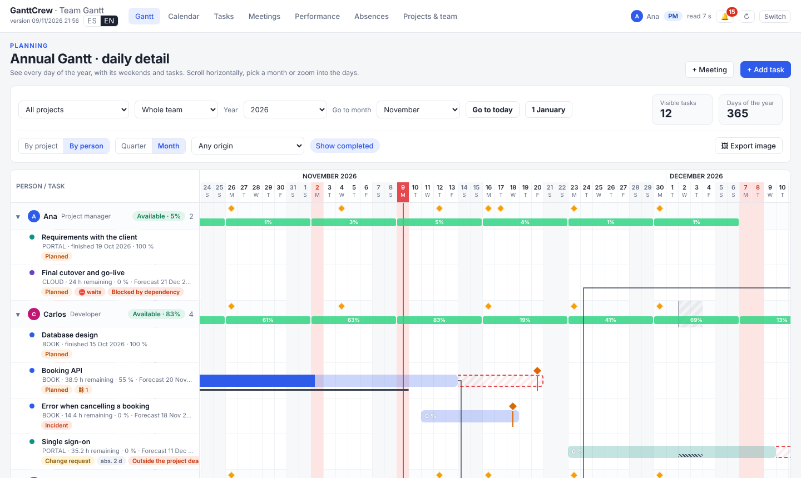
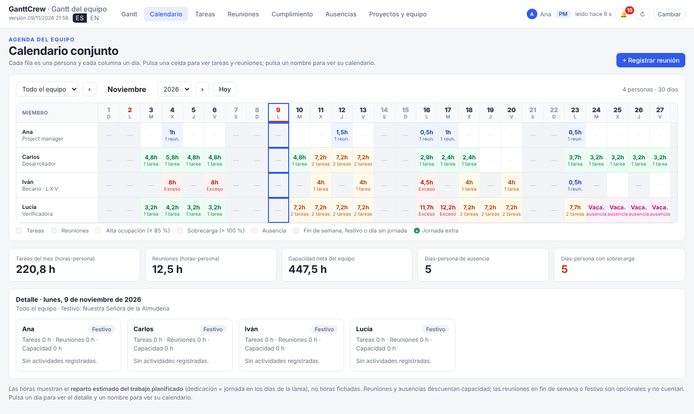

# Manual de usuario de GanttCrew

**Autor:** Schon LIANG

[English version](manual.en.md)

Este manual corresponde a la **versión 1.4.0** de la herramienta. Es el mismo documento en el repositorio de
GitHub y en el paquete que se instala en la carpeta compartida (allí, como `MANUAL DE USUARIO.html`).

Los nombres de botones y pestañas aparecen tal como se ven en la interfaz en español. El archivo de la
herramienta se llama `GanttCrew.html`; tu organización puede haberle dado otro nombre (por ejemplo,
«Gantt del equipo.html»). Funciona igual.

## Índice

**Parte I · Empezar**

1. [Qué es y cómo funciona](#qué-es-y-cómo-funciona)
2. [Puesta en marcha](#puesta-en-marcha)
3. [Instalar una versión nueva](#instalar-una-versión-nueva)
4. [Idioma](#idioma)

**Parte II · Uso diario**

5. [Proyectos y equipo](#proyectos-y-equipo)
6. [Tareas](#tareas)
7. [Gantt](#gantt)
8. [Calendario](#calendario)
9. [Reuniones](#reuniones)
10. [Ausencias, festivos y jornadas extra](#ausencias-festivos-y-jornadas-extra)
11. [Pausar, cancelar y reanudar](#pausar-cancelar-y-reanudar)
12. [Avisos](#avisos)
13. [Diario de trabajo](#diario-de-trabajo)
14. [Cumplimiento y evaluaciones](#cumplimiento-y-evaluaciones)
15. [Proyectos privados](#proyectos-privados)
16. [Exportar: imagen y Excel](#exportar-imagen-y-excel)

**Parte III · Datos, copias y traspasos**

17. [Dónde están los datos](#dónde-están-los-datos)
18. [Copias de seguridad](#copias-de-seguridad)
19. [Contraseñas y código de recuperación](#contraseñas-y-código-de-recuperación)
20. [Un miembro deja el equipo](#un-miembro-deja-el-equipo)
21. [Traspasar una tarea a otra persona](#traspasar-una-tarea-a-otra-persona)
22. [Reuniones periódicas cuando cambia una persona](#reuniones-periódicas-cuando-cambia-una-persona)
23. [Traspasar la dirección del equipo a otro PM](#traspasar-la-dirección-del-equipo-a-otro-pm)
24. [Resumen: qué copia hace falta en cada caso](#resumen-qué-copia-hace-falta-en-cada-caso)

**Parte IV · Más información**

25. [Preguntas frecuentes](#preguntas-frecuentes)
26. [Historial de versiones](#historial-de-versiones)

---

# Parte I · Empezar

## Qué es y cómo funciona

GanttCrew es una herramienta de planificación y control de proyectos para equipos pequeños. Es **un solo
archivo HTML** que se abre en el navegador; no necesita servidor, instalación ni cuentas.

- **Un archivo y una carpeta.** El archivo de la herramienta y, a su lado, la carpeta `datos`, donde se
  guarda todo. Los dos viven en una carpeta compartida y sincronizada (OneDrive, SharePoint, Google Drive
  para ordenador, Dropbox, unidad de red…).
- **Navegador:** Microsoft **Edge** o Google **Chrome** de escritorio. Firefox, Safari y los móviles no
  sirven, porque no permiten a una página trabajar con una carpeta del ordenador.
- **Dos papeles.**
  - **Project manager (PM)**: entra con contraseña. Es el único que planifica: crea proyectos, tareas y
    miembros, asigna, cambia fechas, dedicación y dependencias, gestiona festivos y ve las evaluaciones.
  - **Miembro del equipo**: elige su nombre al entrar, sin contraseña. Ve todo el plan, informa del avance
    de sus tareas (estado, avance, horas pendientes, fechas reales y motivo de bloqueo), registra sus
    ausencias y reuniones y lleva su diario.
- **Cada persona escribe en su propio archivo** dentro de `datos`, así que la sincronización no genera
  conflictos. La herramienta vuelve a leer la carpeta cada 20 segundos; el botón **↻** de la cabecera lo
  fuerza. **Cambiar**, en la cabecera, sirve para entrar con otro nombre.
- **Fecha prevista.** Además de las fechas planificadas, cada tarea tiene un **fin previsto** que la
  herramienta calcula día a día con el calendario real de su responsable. Es la base de los avisos.
- **Versión.** La fecha y hora de publicación (hora de Madrid) aparecen bajo el título, en la pantalla de
  entrada y en *Proyectos y equipo → Versión de la herramienta*. Si dos personas ven versiones distintas,
  alguien tiene un archivo antiguo.
- **Acerca de.** El botón **ℹ** junto a la versión, o el enlace del pie de página, abre la ventana **Acerca
  de GanttCrew**: número de versión, autoría, licencia (MIT) y enlace al código fuente.

## Puesta en marcha

### El project manager, una vez

1. Copia en la unidad compartida una carpeta (por ejemplo «Gantt del equipo») con el archivo de la
   herramienta, este manual y una carpeta vacía `datos`.
2. Comparte la carpeta con el equipo con permiso de edición. En OneDrive: clic derecho → **Compartir** →
   añade a las personas con «Puede editar».
3. Haz que la carpeta esté siempre en tu ordenador. En OneDrive: clic derecho → **Mantener siempre en este
   dispositivo**.
4. Abre el archivo de la herramienta con **Edge o Chrome** (clic derecho → *Abrir con*).
5. Pulsa **Elegir carpeta de datos**, selecciona la carpeta `datos` y acepta el permiso.
6. Como la carpeta está vacía, aparece **Carpeta vacía: crear el equipo**: escribe tu nombre y la
   contraseña de PM (8 caracteres o más).
   - Si marcas **Cargar los datos de ejemplo**, se crea la empresa ficticia Astrorel con tres proyectos,
     tres personas, tareas y reuniones para explorar. Desmárcalo para empezar en blanco.
   - Justo después aparece un **código de recuperación**. Guárdalo fuera de la carpeta compartida: si
     olvidas la contraseña, con él pones una nueva (ver [Contraseñas y código de
     recuperación](#contraseñas-y-código-de-recuperación)).
7. En **Proyectos y equipo**, revisa los centros de trabajo (el municipio de cada sede), añade a las
   personas con su centro, jornada y correo, y crea los proyectos.

### Cada miembro, una vez

1. Abre el enlace de la carpeta que le llega de OneDrive y pulsa **Agregar acceso directo a Mis archivos**,
   para que se sincronice en su ordenador.
2. En el Explorador de archivos: clic derecho sobre la carpeta → **Mantener siempre en este dispositivo**.
3. Abre el archivo de la herramienta con Edge o Chrome, pulsa **Elegir carpeta de datos**, elige `datos` y
   después su nombre en **¿Quién eres?**

El navegador recuerda la carpeta. Si alguna vez vuelve a pedir permiso, basta con pulsar **Abrir**.

## Instalar una versión nueva

1. **Antes**, el PM hace una copia completa: *Proyectos y equipo → Copia de seguridad → Descargar copia
   (.json)* (ver [Copias de seguridad](#copias-de-seguridad)).
2. Sustituye **solo** el archivo de la herramienta (y este manual). **No toques la carpeta `datos`.**
3. Pide a todo el equipo que recargue la página (F5) y compruebe la versión bajo el título.
4. Cuando el [historial de versiones](#historial-de-versiones) diga «todo el equipo a la vez», nadie debe
   seguir usando la versión anterior: las versiones antiguas no entienden algunos datos nuevos.

Al abrir una versión nueva, la herramienta muestra sus **novedades**. No se pierde ningún dato.

## Idioma

El selector **ES | EN** está junto a la versión, arriba a la izquierda, y en la esquina superior derecha de
las pantallas de entrada. El cambio es inmediato; cada persona elige el suyo y se recuerda en su navegador.
Se traducen la interfaz, las fechas, la imagen exportada, el Excel y los calendarios `.ics`. Los datos que
escribe cada persona (nombres de proyectos, tareas, reuniones) no cambian.

---

# Parte II · Uso diario

## Proyectos y equipo

En la pestaña **Proyectos y equipo** (casi todo lo cambia solo el PM):

- **Proyectos** (**+ Proyecto**): nombre, **código corto** (se genera a partir del nombre; ↻ lo regenera
  y se puede escribir a mano), tipo, color, responsable, **participantes**, fechas de inicio y **fin
  objetivo**, programa u organismo y descripción. Los participantes sirven para las reuniones del
  proyecto; no hace falta que tengan tareas.
- **Estado del proyecto**: activo, en pausa, **Cerrado (terminado)** o **Cancelado** (con fecha y
  motivo). Ver [Pausar, cancelar y reanudar](#pausar-cancelar-y-reanudar).
- **Tipos de proyecto**: lista editable (nombre, color y orden). Al renombrar un tipo se actualiza en
  todos los proyectos.
- **Equipo** (**+ Miembro**): nombre, rol, color, **correo** (sirve para reconocerle en las convocatorias
  importadas), **horas disponibles por día**, **días de trabajo** (por ejemplo, un becario: L, X y V a
  4 h), **centro de trabajo**, **fecha de incorporación** (las reuniones periódicas de todo el equipo solo
  le cuentan desde esa fecha) y **fecha de baja**.
- **Centros de trabajo y calendario laboral**: cada centro tiene un municipio, que decide qué festivos
  locales se aplican a sus personas.
- **Escala de calidad** y **pesos** del índice de cumplimiento (ver [Cumplimiento y
  evaluaciones](#cumplimiento-y-evaluaciones)).
- **Dirección del equipo 🔒** (PM): cambiar la contraseña, crear el código de recuperación y traspasar la
  dirección.
- **Copia de seguridad 🔒** (PM), **Thunderbird** y **Versión de la herramienta**.

## Tareas

Las crea el PM con **+ Tarea** (Gantt), **+ Añadir tarea** o el botón **+** de la fila de un proyecto.

- **Origen**: *Planificada*, *Detectada en desarrollo*, *Incidencia* o *Cambio solicitado*. Las tres
  últimas cuentan como trabajo no planificado, con quién lo detectó y cuándo.
- **Prioridad**: alta, media o baja. En la previsión, las de prioridad alta se atienden primero.
- **Dependencias**: la tarea no puede avanzar ni completarse hasta que terminen aquellas de las que depende
  (el PM puede permitirlo de forma excepcional). Si empieza antes de que acabe su dependencia, la ficha
  propone una fecha de inicio coherente.
- **Dedicación prevista (% de su jornada)** y **horas estimadas**: con ellas se calculan la carga y la
  fecha prevista. Si no hay horas estimadas, cuenta la dedicación durante las fechas planificadas.
- **Colaboradores**: otras personas que ayudan al responsable, cada una con su dedicación (% de su
  jornada). Sus horas cuentan en su carga y en el aviso de sobrecarga, y adelantan la fecha prevista. Ven la
  tarea en su Gantt, su calendario y su lista (al filtrar por su nombre) y reciben un aviso en la campana al
  añadirlos. En la lista de tareas aparecen como «+1», «+2»… junto al responsable. El avance lo sigue
  informando el responsable. Su ayuda cuenta hasta que la tarea termina. Ojo: si la tarea **no tiene horas
  estimadas**, su tamaño se calcula sumando lo que aporta cada uno, así que añadir un colaborador sin bajar
  la dedicación del responsable la hace más grande, no más corta. Para que la ayuda la adelante, pon las
  horas estimadas o baja la dedicación del responsable.
- **Avance** y **horas pendientes**: si dejas las horas pendientes vacías, se calculan a partir del avance.
- **Estado**: Pendiente, En curso, Bloqueada (con motivo) o Completada.
- **Fechas reales de inicio y fin**: al pasar a «en curso» o «completada», la herramienta propone la fecha
  de hoy. Se pueden dejar en blanco, también en una tarea completada (por ejemplo, si se cumplió lo
  planificado o no se recuerda). Una tarea completada sin fin real se dibuja hasta su fin planificado y no
  cuenta en la puntualidad.
- **Descripción** con formato: `**negrita**`, `*cursiva*`, listas con «- » o «1. » y enlaces.

Los **miembros** solo actualizan sus propias tareas (estado, avance, horas pendientes, fechas reales y
motivo de bloqueo). Las de los demás las ven en modo «Tarea (solo lectura)». Si una fecha es todavía
incierta, el PM pone una provisional razonable y lo indica en la descripción.

**Avisos de la ficha antes de guardar** (se puede guardar igualmente):

- sobrecarga o carga al límite del responsable o de algún colaborador;
- ausencias durante la tarea;
- inicio o fin en un día no laborable;
- fin posterior al fin objetivo del proyecto.

**Cómo se calcula el fin previsto.** La herramienta simula cada día laborable del responsable desde hoy:
descuenta festivos, ausencias y reuniones, reparte sus horas entre sus tareas abiertas según la prioridad y
la dedicación, suma la ayuda de los colaboradores y respeta las dependencias. El día en que se agotan las
horas pendientes es el fin previsto. Si cae después del fin planificado, la tarea aparece con **retraso
previsto**. Las fórmulas completas, con un ejemplo, están en [Carga de trabajo y fecha
prevista](https://github.com/Northwalking/GanttCrew/blob/main/docs/carga-y-prevision.es.md).

## Gantt

- **Gantt anual · detalle diario**: un año completo, día a día. **Año**, **Ir al mes**, **Ir a hoy** y
  **1 de enero** sirven para moverse. El Gantt y el Calendario comparten el año y el mes.
- **Por proyecto / Por persona**: la vista por persona muestra la carga semanal de cada uno (verde; ámbar
  desde el 85 %; rojo por encima del 100 %), sus ausencias y sus reuniones, y una tabla de carga de las
  próximas semanas.
- **Trimestre / Mes**: ancho de cada día. En *Mes* se puede pulsar un día de la cabecera para abrir su
  detalle en el Calendario.
- **Filtros**: proyecto, persona, origen, **Mostrar completadas** y, para el PM, **🔒 Privados: visibles/ocultos**
  (útil al compartir pantalla).

**Cómo leer una barra**

| Elemento | Significado |
|---|---|
| Relleno de la barra | Plan; la parte oscura es el avance |
| Línea fina bajo la barra | Fechas reales |
| Rombo naranja con línea | Fin previsto |
| Zona roja discontinua | Desde el fin planificado hasta el fin previsto (retraso) |
| Flecha | Dependencia (fin → inicio); roja discontinua = empieza antes de que acabe la anterior |
| Tramo atenuado | En pausa o cancelada desde esa fecha |
| Tramo con línea punteada | Periodo en que estuvo en pausa |
| «⇄ 1.ª parte» / «⇄ continuación» | Tarea traspasada a otra persona |
| «Fuera del plazo del proyecto» | Acaba o está prevista después del fin objetivo del proyecto |

**Reuniones en el Gantt.** Cada reunión es un rombo naranja en su día. Si un día tiene **varias**, se ve un
solo rombo más oscuro con el número de reuniones; al pasar el ratón aparecen todas con su horario y al
pulsarlo se abre la lista para entrar en cualquiera.

El PM puede arrastrar las barras para cambiar las fechas.

## Calendario

- **Calendario conjunto**: cada fila es una persona y cada columna un día. Cada celda muestra las horas
  previstas y el número de tareas y reuniones, coloreada por ocupación; también ausencias, festivos y
  jornadas extra. Pulsa una celda para ver el detalle del día y un nombre para ver su calendario personal.
- **Calendario de una persona**: el mes en cuadrícula, con sus tareas, reuniones, ausencias y festivos.
- Las horas son el **reparto estimado del trabajo planificado**, no horas fichadas.

## Reuniones

- **+ Reunión**: título, tipo, proyecto, fecha, **hora de inicio y de fin** (como en Outlook; al mover el
  inicio, el fin se mueve con él), asistentes y notas (con formato).
- **Privacidad**: el título, el tipo, el proyecto y las notas solo los ven los asistentes y quien la creó.
  El resto, también el PM, solo ve que esas personas están **reunidas** (día, hora y quiénes), con 🔒. Aun
  así, la reunión resta horas de trabajo y cuenta en las fechas previstas.
- **Quién la gestiona**: quien la creó; el PM, además, las que tiene como asistente.
- **Asistentes**: personas elegidas, **Todo el equipo** o **Participantes del proyecto** (si cambian los
  participantes, cambian los asistentes). Al filtrar por asistente, el título indica cuántas cumplen el
  filtro («asiste Lucía: 5 de 6»).
- **Reuniones periódicas** (**Repetir**): cada día laborable, cada día (también fines de semana), cada
  semana o cada dos semanas (eligiendo los días, por ejemplo martes y jueves) o cada mes, con fecha **Hasta**
  opcional. «No ponerla en festivos de todo el equipo» viene marcado. Al modificar o borrar una se elige
  *Solo esta reunión*, *Esta y las siguientes* o *Toda la serie*. Quien se incorpore entra en las de *Todo
  el equipo* desde su fecha de incorporación.
- **Fin de semana o festivo**: esas reuniones son opcionales («fin de semana · opcional») y no cuentan en
  las horas, la carga ni las fechas previstas.
- **Seleccionar varias**: marca reuniones pulsándolas, o filtra y pulsa **Marcar las N**. Para filtrar,
  escribe en el buscador **solo una palabra del título** (por ejemplo, briefing) y elige el periodo en el
  desplegable (por ejemplo, *Desde hoy (todas las futuras)*). Después puedes **Modificar las
  seleccionadas** (añadir o quitar asistentes, proyecto, tipo, hora y duración) o **Eliminar las
  seleccionadas**.
- **Importar .ics**: desde un archivo de calendario `.ics` o un correo `.eml` con una convocatoria (Outlook
  y otros). Los asistentes se reconocen por su correo; sin correo, solo si el nombre coincide exactamente.

### Thunderbird

Se configura en *Proyectos y equipo*, tarjeta **Thunderbird**.

- **Convocatorias → herramienta.** Pulsa **Crear mi archivo para Thunderbird**: se crea
  `datos/thunderbird-<tu-nombre>.ics`. En Thunderbird: Alt → **Archivo → Abrir → Archivo de calendario…**
  → ese archivo, **sin** marcar solo lectura. En sus propiedades, en «Correo electrónico», elige la cuenta
  donde recibes las convocatorias. Las que aceptes se registran solas como reuniones, también las
  periódicas.
- **Plan → Thunderbird.** `datos/calendario-<tu-nombre>.ics` (y `calendario-equipo.ics`) se abren igual,
  pero **en solo lectura**. No confundas los dos archivos. También sirven para Outlook.
- **Ocultar toda la serie**: en una convocatoria periódica importada, quita de la herramienta todas sus
  reuniones, también las futuras, sin tocar Thunderbird. Se vuelve a mostrar en la tarjeta de Thunderbird.
  Borrarlas no sirve: volverían en la siguiente sincronización.

## Ausencias, festivos y jornadas extra

En la pestaña **Ausencias**:

- **+ Ausencia**: vacaciones, ausencia con permiso, baja médica, viaje de proyecto (con disponibilidad
  parcial, 50 % por defecto), congreso o formación, u otra.
  - **Días completos** (desde y hasta qué día) o **Por horas** (un día, desde y hasta qué hora): esas horas
    se descuentan de su jornada.
  - El equipo ve los días o el horario de la ausencia. En una **baja médica**, el resto solo ve «Ausente»,
    sin el tipo ni la nota. No escribas datos médicos.
- **Festivos** en tres niveles: **nacionales** (todo el equipo), **autonómicos** y **locales** (según el
  municipio del centro de cada persona), además de los de **empresa o centro**. No cuentan como días
  laborables.
- **Festivos de años siguientes.** **Importar festivos (BOCM)**: sube el PDF del decreto autonómico de
  fiestas (se publica a finales de septiembre) o de la resolución de fiestas locales (diciembre), o pega su
  texto; la herramienta muestra lo encontrado antes de guardar. Si el formato cambia y no reconoce todas
  las fechas, o para otras regiones, añádelas con **+ Festivo** o con **Copiar los de fecha fija a** el año
  siguiente. Un aviso naranja en *Ausencias* indica qué falta.
- **+ Jornada extra**: alguien trabaja puntualmente un sábado, domingo, festivo o día que no le toca, con
  horas y tarea opcional. Esas horas cuentan en su carga y adelantan la fecha prevista de la tarea elegida
  (o de todas sus tareas en curso).

## Pausar, cancelar y reanudar

En la ficha de una tarea, sección **Estado** (PM):

- **⏸ Pausar**: fecha y motivo. Mientras dure, la tarea no cuenta en la carga ni en las previsiones y no
  genera avisos. En el Gantt se ve el plan vigente atenuado desde esa fecha.
- **✕ Cancelar**: igual, pero además deja de contar en el cumplimiento.
- **▶ Reanudar** / **↻ Reactivar**: por defecto, el fin planificado se desplaza los días laborables que duró
  la pausa; se puede corregir. Se puede pausar y reanudar varias veces; el historial queda en la ficha y el
  Gantt dibuja la barra por tramos.

En un **proyecto** (su ficha, en *Proyectos y equipo*), pausar, cancelar, reanudar o reactivar aplica el
cambio a sus tareas abiertas. Al pausar puedes desmarcar las que siguen en curso; al reanudar, una tabla
propone el nuevo fin de cada tarea, editable.

## Avisos

La campana 🔔 de la cabecera muestra el número de avisos, en rojo si hay nuevos. Al entrar aparece un aviso
breve.

- **Fechas**: tareas que vencen en los próximos 5 días laborables, vencidas, con retraso previsto o que
  acaban después del fin objetivo de su proyecto; proyectos cuyo fin objetivo llega en 10 días laborables,
  ya ha pasado o no se cumplirá.
- **Asignaciones** (durante 14 días): «Tarea nueva asignada a ti», «Reasignada a ti (antes la llevaba…)»,
  «Ya no es tuya: ahora la lleva…» y «Colaboras en esta tarea».
- **Responsable de baja**: tareas abiertas de alguien que ya dejó el equipo.

Cada miembro ve los de sus tareas y de los proyectos de los que es responsable; el PM, los de todo el
equipo. La herramienta **no envía correos**: no tiene servidor, así que los avisos solo aparecen dentro de
ella.

## Diario de trabajo

La pestaña **Diario** es un registro personal de lo que haces cada día. Es solo un registro: no cuenta horas.

- **Es privado y está cifrado** (`datos/diario-<persona>.json`). El PM lo abre con su contraseña de PM.
  Cada miembro crea, la primera vez, la **contraseña de su diario** y recibe un **código de recuperación**.
  Nadie más puede leerlo, tampoco el PM. *Recordar en este navegador* evita escribirla cada vez (no lo
  marques en un ordenador compartido).
- **Día**: escribe una línea y pulsa Intro. La herramienta propone las reuniones y tareas que tenías ese
  día para añadirlas con un clic. Cada línea puede asociarse a un proyecto.
- **Pendientes**: marca una línea como *Pendiente* y síguela en la vista **Pendientes**; al pulsar
  *Resolver* queda la fecha en que se cerró.
- **Formato**: `**negrita**`, `*cursiva*`, subpuntos con Mayús+Intro y «- », y enlaces.
- **Mes** y **buscador** para repasar lo anotado.
- **Importar…**: un Word (`.docx`) o un texto en el que cada día empiece por «Día 11/06/2026».
- **Descargar…**: un periodo, o todo, en Word o en texto. El archivo descargado **no va cifrado**.
- **🔑**: crear un código de recuperación nuevo (el anterior deja de servir).

## Cumplimiento y evaluaciones

La pestaña **Cumplimiento** resume tareas completadas y entregadas a tiempo, tareas en riesgo, bloqueadas o
esperando, trabajo no planificado y sobrecarga prevista.

**Solo el PM** ve el **índice de calidad de cumplimiento** (0–100) por tarea, persona y proyecto. Al
completar una tarea, el PM la evalúa en su ficha: calidad (1–5 ★, según la escala), alcance entregado (%) y
número de retrabajos. El plazo sale de la fecha real de fin. Para quitar una evaluación, pulsa otra vez la
estrella marcada o **Quitar evaluación**, y guarda. Los pesos se ajustan en *Proyectos y equipo*.

Las evaluaciones se guardan cifradas con la contraseña del PM.

## Proyectos privados

El PM puede marcar un proyecto como **Privado (solo yo)**, para usarlo como agenda personal:

- se guarda cifrado en `privado-pm.json` y el equipo no lo ve en ninguna vista, cálculo ni calendario;
- sus tareas no cuentan en tu jornada laboral;
- su fecha prevista usa un calendario propio: las horas al día que indiques en *Proyectos y equipo* (2 h
  por defecto), todos los días;
- el botón **🔒 Privados: visibles/ocultos** del Gantt los muestra u oculta en tu pantalla.

La copia de seguridad (`.json`) los incluye **sin cifrar**: guárdala en un sitio privado.

## Exportar: imagen y Excel

**🖼 Exportar imagen** (en el Gantt): el mismo diagrama de la herramienta para pegarlo en Word. Elige un
proyecto (o todos), las tareas (por ejemplo, una fase), el periodo, el título, la escala (días, semanas,
meses o trimestres) y si se incluyen la leyenda y la cabecera. **Copiar imagen** la deja en el portapapeles
(Ctrl+V en Word); **Descargar PNG** la guarda.

**Exportar a Excel** (en el Gantt): un libro `.xlsx` para quien no usa la herramienta. Eliges proyecto,
periodo, escala (semanas o días) y si se incluyen las completadas.

- Hoja **Gantt**: una fila por tarea con responsable (y colaboradores), fechas, avance y estado, y una
  celda por semana o día con el color de cada persona (oscuro = avance, claro = pendiente, rosa = retraso
  previsto, gris = en pausa o cancelada; naranja en la cabecera = hoy).
- Hoja **Tareas**: las mismas tareas en una tabla con filtros.

Es una foto del momento: si cambia el plan, hay que volver a exportar. **Nunca se exportan** los proyectos
privados, las evaluaciones ni los diarios.

La imagen y el Excel llevan al pie una línea discreta, «Generado con GanttCrew …», con la versión y la autoría.
Los archivos que genera la herramienta (Excel, Word del diario y calendarios `.ics`) indican también en sus
propiedades el programa que los creó; como autor del documento figura la persona que lo exporta.

---

# Parte III · Datos, copias y traspasos

Esta parte explica, paso a paso, cómo guardar copias de los datos y cómo hacer los cambios de personas sin
perder el histórico. Léela entera antes de traspasar la dirección del equipo: es la única operación que
**no se puede deshacer**.

## Dónde están los datos

Todo está en la carpeta `datos`, junto al archivo de la herramienta:

| Archivo | Qué contiene | Quién lo escribe | Cifrado |
|---|---|---|---|
| `equipo-pm.json` | Proyectos, equipo, ajustes, festivos y lo que registra el PM | El PM | No |
| `miembro-<id>.json` | Lo que registra cada miembro: avance de sus tareas, ausencias, reuniones | Cada miembro | No |
| `evaluaciones-cifradas.json` | Evaluaciones de calidad | El PM | Sí, con la contraseña de PM |
| `privado-pm.json` | Proyectos privados del PM | El PM | Sí, con la contraseña de PM |
| `diario-<id>.json` | Diario de trabajo de cada persona | Cada persona | Sí, con su propia clave |
| `thunderbird-<nombre>.ics` | Convocatorias aceptadas en Thunderbird | Thunderbird | No |
| `calendario-….ics` | Calendarios para suscribirse | La herramienta | No |

- Cada persona escribe en su propio archivo, así OneDrive no genera conflictos. La herramienta junta todos
  al leer. Si aparece un archivo `…-NOMBREPC.json` (copia en conflicto de OneDrive), no pasa nada.
- **Las reglas de quién edita qué las aplica la herramienta.** Alguien con permiso de edición en la carpeta
  podría modificar los archivos a mano. Lo cifrado (evaluaciones, proyectos privados y diarios) sí está
  protegido.
- **La privacidad de las reuniones es de la herramienta, no de los archivos**: los datos de reuniones no
  están cifrados.
- **Lo cifrado depende de una contraseña que nadie puede restablecer**, salvo con su **código de
  recuperación**. Sin contraseña ni código, si se pierde la de PM se pierden las evaluaciones, los proyectos
  privados y el diario del PM; si alguien olvida la de su diario, se pierde ese diario.
- **El diario del PM** se cifra con la contraseña de PM; el de cada miembro, con la de su diario.

## Copias de seguridad

Hay varias formas de guardar copia. Se complementan; usa al menos las dos primeras.

### Copia completa desde la herramienta (PM)

Es la copia principal. Guarda en un solo archivo todo lo que gestiona el equipo.

1. Entra como PM.
2. Ve a **Proyectos y equipo** y baja hasta **Copia de seguridad 🔒**.
3. Pulsa **Descargar copia (.json)**. Se descarga `copia-gantt-AAAA-MM-DD.json`.
4. Muévelo a un sitio **privado y fuera de la carpeta compartida** (tu OneDrive personal, un disco externo).

**Qué incluye:** proyectos, tareas, equipo, reuniones, ausencias, festivos, jornadas extra, ajustes, tus
proyectos privados y **las evaluaciones sin cifrar**. **Qué no incluye:** los diarios ni los archivos de
Thunderbird.

**Cuándo hacerla:** una vez por semana o tras una sesión larga de planificación; **antes de instalar una
versión nueva**; **antes de un traspaso de la dirección** y justo después (la hace el nuevo PM); antes de
borrar un proyecto o de restaurar otra copia.

> Como lleva las evaluaciones sin cifrar, trata este archivo como confidencial.

### Copia de la carpeta `datos` entera

Es la copia más completa: incluye también los diarios (cifrados) y los archivos de Thunderbird.

1. Pide al equipo que no edite durante un minuto y espera a que OneDrive termine de sincronizar (marca
   verde).
2. Copia la carpeta `datos` completa a un sitio privado, con la fecha en el nombre (por ejemplo
   `datos 2026-11-13`).

Para recuperarla, se sustituye la carpeta `datos` por la copia. Los archivos cifrados siguen necesitando las
contraseñas que estaban en uso **el día de la copia**.

### Historial de versiones de OneDrive

Sirve para recuperar **un archivo concreto** si se ha estropeado o borrado.

1. En OneDrive (web) o en el Explorador, clic derecho sobre el archivo, por ejemplo `equipo-pm.json`.
2. Elige **Historial de versiones** y restaura la versión del día que necesites.
3. En la herramienta, pulsa ↻ para volver a leer la carpeta.

### El diario de cada persona

Cada uno guarda el suyo; nadie más puede hacerlo por él.

1. Pestaña **Diario** → **Descargar…**
2. Elige el periodo (**Todo el diario** para una copia completa) y el formato **Word (.docx)** o **Texto**.
3. Pulsa **Descargar**. El archivo **no va cifrado**: guárdalo en un sitio privado.

Para volver a cargarlo: **Diario → Importar…** y elige ese archivo. Las anotaciones iguales no se duplican.

### Restaurar una copia `.json` en el equipo

1. Entra como PM y haz antes una copia del estado actual, por si acaso.
2. **Proyectos y equipo → Copia de seguridad → Restaurar desde copia…** y elige el archivo.
3. Comprueba el Gantt y pide al equipo que recargue la página (F5).

Los elementos que contiene la copia vuelven a como estaban ese día, **aunque alguien los haya cambiado
después**. Lo creado después de la copia se conserva. Las evaluaciones y los proyectos privados de la copia
se vuelven a cifrar con tu contraseña actual.

### Consultar una copia en una carpeta aparte (copia personal)

Sirve para conservar y consultar tu histórico sin tocar los datos del equipo, por ejemplo después de dejar
la dirección.

1. Crea una carpeta nueva **tuya** con el archivo de la herramienta y una carpeta `datos` vacía.
2. Abre la herramienta con Edge o Chrome y elige esa carpeta `datos`.
3. En **Carpeta vacía: crear el equipo**, escribe tu nombre y una contraseña nueva, y **desmarca** «Cargar
   los datos de ejemplo».
4. **Proyectos y equipo → Copia de seguridad → Restaurar desde copia…** y elige tu copia `.json`.
5. Tendrás el Gantt, el calendario, las tareas y tus proyectos privados tal como estaban ese día (y las
   evaluaciones, si la copia las llevaba).
6. Para tu diario: **Diario → Importar…** y elige el Word que descargaste.

## Contraseñas y código de recuperación

Los miembros no tienen contraseña para entrar; solo la de su diario. La única contraseña de acceso es la del
PM.

### Cambiar la contraseña de project manager

1. Comprueba que OneDrive está sincronizado y que no hay otra ventana de la herramienta abierta como PM.
2. **Proyectos y equipo → Dirección del equipo 🔒 → Cambiar la contraseña…**
3. Escribe la actual y la nueva dos veces (8 caracteres o más). Pulsa **Cambiar**.
4. Espera el aviso «Contraseña cambiada».

Las evaluaciones, tus proyectos privados y tu diario se vuelven a cifrar con la nueva; los miembros no notan
nada. Al terminar recibes un **código de recuperación nuevo** (el anterior deja de servir).

### Si olvidas una contraseña: el código de recuperación

Al crear la contraseña de PM (al crear el equipo o al cambiarla) y al crear la de un diario, la herramienta
muestra **una sola vez** un código de 20 caracteres, por ejemplo `7KQ2M-X9D4T-…`. No se guarda en ningún
sitio: guárdalo tú fuera de la carpeta compartida (gestor de contraseñas, papel en un cajón o archivo
personal). Se puede copiar o descargar en `.txt`. Con él se pone una contraseña nueva sin perder nada.

- **PM:** en «¿Quién eres?», elige tu nombre, pulsa **¿Has olvidado la contraseña?**, escribe el código y la
  contraseña nueva dos veces. Entras como PM y recibes un código nuevo.
- **Miembro, su diario:** en **Diario**, pulsa **¿Has olvidado la contraseña?**, escribe el código y la
  contraseña nueva. El código del diario solo lo ve su dueño; el del PM no abre los diarios de los demás.
- **Crear un código nuevo**: el PM, en **Dirección del equipo 🔒**, donde también ve si ya tiene uno; cada
  miembro, con el botón 🔑 de su diario. Los equipos y diarios creados antes de la versión 1.2.0 no tienen
  código: créalo cuanto antes.
- **Cuidado:** quien tenga el código de PM puede hacerse con el papel de PM; quien tenga el de un diario,
  leerlo. Si crees que alguien lo ha visto, crea uno nuevo.

## Un miembro deja el equipo

**Antes de su último día**

1. Pídele que descargue su diario si quiere conservarlo. Nadie más puede abrirlo.
2. Repasa con él sus tareas abiertas y el avance real de cada una.

**El PM registra la baja**

3. **Proyectos y equipo →** pulsa su nombre en **Equipo**.
4. En **Fecha de baja**, pon su **último día en el equipo** y pulsa **Guardar**.
5. Se abre la lista **Tareas abiertas** de esa persona. En cada una, pulsa **Traspasar…** (ver [Traspasar
   una tarea](#traspasar-una-tarea-a-otra-persona)). Puedes volver más tarde: las tareas sin traspasar
   aparecen en la campana 🔔 como «Responsable de baja».

**Qué cambia desde el día siguiente a la baja**

- No aparece en «¿Quién eres?» ni en las listas para asignar tareas, ausencias o reuniones.
- No cuenta en la carga ni en las fechas previstas, y sale de las reuniones periódicas posteriores.
- Su histórico se conserva con su nombre: tareas terminadas, reuniones, ausencias y evaluaciones.

**Después**

6. Si era participante de proyectos en curso, quítalo de la ficha de cada proyecto si no quieres que siga
   figurando.
7. Su `diario-<id>.json` puede borrarse de `datos` cuando ya no lo necesite.
8. Retírale el acceso a la carpeta compartida.

**Si vuelve al equipo:** borra la fecha de baja en su ficha y lo recupera todo.

> No elimines al miembro con **Eliminar**: se perdería la referencia en su histórico. La herramienta lo
> impide mientras tenga tareas o ausencias.

## Traspasar una tarea a otra persona

Úsalo cuando alguien deja una tarea a medias y otra persona la continúa. Si la tarea aún no ha empezado, o
quieres pasarla entera, basta con cambiar el **Responsable** en su ficha.

1. Abre la tarea y, en **Estado**, pulsa **⇄ Traspasar…** (solo lo ve el PM, y solo si la tarea está
   activa: si está en pausa, reanúdala antes).
2. **Nuevo responsable:** la persona que continúa.
3. **Último día de** quien la llevaba: hasta esa fecha el trabajo cuenta a su nombre.
4. **Inicio de la continuación:** se propone el primer día laborable de la nueva persona; se puede cambiar.
5. **Fin planificado:** se propone el de la tarea original; si ya no es posible, la herramienta propone el
   que hace falta.
6. **Horas pendientes que se traspasan:** lo que quedaba por hacer; revísalo.
7. **Dedicación:** el porcentaje de jornada de la nueva persona.
8. Lee la línea de comprobación (días laborables y horas de la nueva persona). Si aparece en rojo **«No
   llega al fin planificado»**, amplía la fecha o la dedicación.
9. Pulsa **Traspasar**.

**Qué queda después**

| | Primera parte | Continuación |
|---|---|---|
| Responsable | Quien la llevaba | La nueva persona |
| Fechas | Inicio original → último día | Inicio de la continuación → fin planificado |
| Estado | Completada, con «Traspasada a …» | Pendiente |
| Horas | Las que llevaba hechas | Las pendientes |
| En el Gantt | «⇄ 1.ª parte» | «⇄ continuación», enlazada a la anterior |

Las tareas que dependían de la original pasan a depender de la continuación. La primera parte se puede
evaluar como cualquier tarea completada. En la ficha de cada una hay un enlace a la otra.

**Ejemplo.** Tarea del 1 de junio al 22 de diciembre, de Carlos, que deja el equipo el 5 de septiembre. Con
último día 5 de septiembre, la de Carlos queda del 1 de junio al 5 de septiembre, completada; Iván recibe la
continuación del 7 de septiembre (su primer día laborable) al 22 de diciembre, con las horas pendientes.

**Si te equivocas:** no hay botón para deshacer. Corrige la continuación (responsable, fechas u horas), o
bórrala y, en la primera parte, vuelve a poner «En curso», el fin planificado original y quita el fin real.

## Reuniones periódicas cuando cambia una persona

- **Quien causa baja** sale sola de las reuniones periódicas posteriores a su fecha.
- **Para añadir a quien le sustituye desde una fecha:** abre la reunión de ese día, en **Aplicar los
  cambios a** elige **Esta y las siguientes**, marca a la nueva persona y guarda.
- **Para varias reuniones a la vez:** **Reuniones → Seleccionar varias**, filtra por proyecto y «Desde hoy»
  y usa **Añadir como asistentes** o **Quitar de los asistentes**.
- Las reuniones de **Participantes del proyecto** siguen a los participantes: basta con cambiar la lista en
  la ficha del proyecto.

## Traspasar la dirección del equipo a otro PM

Lo hace **el PM saliente**, con su sesión abierta. Lo ideal es que el nuevo PM esté presente para escribir
su contraseña. **No se puede deshacer.**

### Antes de empezar

- [ ] El nuevo PM ya es miembro del equipo (si no, **Proyectos y equipo → + Miembro**).
- [ ] OneDrive está sincronizado y el resto del equipo no está editando.
- [ ] Has actualizado el avance de tus tareas. Las que no vayas a continuar, traspásalas o déjalas a tu
      nombre.
- [ ] Has decidido qué hacer con tus **proyectos privados**: se eliminan de la carpeta del equipo. Si
      alguno debe seguir en el equipo, quítale antes la marca «Privado (solo yo)».
- [ ] Tienes a mano tu contraseña actual.

### El traspaso, paso a paso

**Proyectos y equipo → Dirección del equipo 🔒 → Traspasar la dirección del equipo…**

1. **Guarda tu copia personal** (después no podrás). Marca **Incluir las evaluaciones del equipo** solo si
   las necesitas y tu organización lo permite. Pulsa **Descargar copia (.json)** y **Descargar mi diario
   (Word)**, y lleva los dos archivos a un sitio privado.
2. **Nuevo project manager.** Elige a la persona; ella escribe su contraseña dos veces. Si no está, pon una
   provisional, dásela por un canal seguro y que la cambie al entrar.
3. **Tú.** **Sigo en el equipo como miembro** o **Dejo el equipo** (con tu último día).
4. **Lo personal tuyo.** Tus proyectos privados se eliminan de la carpeta. Tu diario: **Conservarlo con una
   contraseña solo mía** o **Eliminarlo de la carpeta del equipo** (si dejas el equipo, se elimina).
5. **Confirmación.** Escribe tu contraseña actual, marca la casilla y pulsa **Traspasar la dirección**. La
   página se recarga y pregunta «¿Quién eres?».

### Qué pasa con cada cosa

| Dato | Después del traspaso |
|---|---|
| Proyectos, tareas, planificación, reuniones, ausencias, festivos, ajustes | Pasan tal cual al nuevo PM |
| Evaluaciones | Se vuelven a cifrar con la contraseña del nuevo PM, que las ve todas |
| Proyectos en curso de los que eras responsable | Pasan a nombre del nuevo PM |
| Tus tareas | Siguen a tu nombre |
| Tu contraseña de PM | Deja de funcionar |
| Tus proyectos privados | Se eliminan de la carpeta (los tienes en tu copia personal) |
| Tu diario | Se conserva con tu contraseña propia, o se elimina |
| Diario del nuevo PM | No cambia |

### Después del traspaso

**El nuevo PM:**

1. Entra con su nombre y su contraseña.
2. Comprueba que ve **Cumplimiento** con las evaluaciones y la tarjeta **Dirección del equipo**.
3. Si la contraseña era provisional, la cambia.
4. Crea su **código de recuperación** en **Dirección del equipo 🔒** (el traspaso no se lo da, para que no
   lo vea el PM saliente) y lo guarda.
5. Hace una **copia completa**: es la primera con su contraseña.
6. Revisa la campana 🔔: si el PM saliente ha causado baja, sus tareas abiertas aparecen como «Responsable de
   baja».

**El PM saliente, si sigue en el equipo:** entra con su nombre, ya sin contraseña, abre **Diario** con la
contraseña elegida en el paso 4 y crea su código de recuperación (🔑).

**Todo el equipo:** recarga la página (F5).

### Si algo va mal

- **La página se cerró a mitad del traspaso.** Entra de nuevo: si tu contraseña antigua funciona, el
  traspaso no se hizo y puedes repetirlo. Si no, prueba con la del nuevo PM. Si ninguna abre las
  evaluaciones, restaura `equipo-pm.json` y `evaluaciones-cifradas.json` con el historial de versiones de
  OneDrive a la hora anterior al traspaso.
- **El nuevo PM olvidó su contraseña.** Si creó su código de recuperación, lo usa. Si no, con una copia de la
  carpeta `datos` anterior al traspaso, el PM saliente puede volver a ese estado y repetirlo.
- **Te fuiste sin hacer el traspaso.** Los datos compartidos se conservan, pero las evaluaciones no se
  pueden recuperar sin tu contraseña (o tu código).

## Resumen: qué copia hace falta en cada caso

| Situación | Qué hacer antes |
|---|---|
| Uso normal | Copia completa cada semana |
| Instalar una versión nueva | Copia completa |
| Baja de un miembro | Que descargue su diario |
| Cambiar la contraseña de PM | Copia completa |
| Traspasar la dirección | Copia de la carpeta `datos`, copia personal y diario (paso 1 del traspaso) |
| Restaurar una copia | Copia completa del estado actual |

---

# Parte IV · Más información

## Preguntas frecuentes

**¿Puedo mover la carpeta a otro sitio?** Sí, con `datos` dentro. Al abrir la herramienta, vuelve a elegir
la carpeta.

**¿Funciona en el móvil?** No: necesita Edge o Chrome de escritorio.

**¿Qué pasa si dos personas cambian algo a la vez?** Cada una escribe en su propio archivo, así que no se
pisan. Si la nube crea una copia en conflicto, la herramienta la tolera.

**¿Se envían correos?** No. Los avisos solo aparecen dentro de la herramienta. El correo de cada miembro
solo sirve para reconocerle en las convocatorias importadas.

**¿Es seguro?** Los permisos los aplica la herramienta, no un servidor: quien tenga permiso de edición en la
carpeta podría modificar los archivos a mano. Las evaluaciones, los proyectos privados y los diarios sí están
cifrados.

**No sé la fecha de inicio de una tarea.** Pon una fecha provisional razonable, escribe «Fechas por
confirmar» en la descripción y corrígela cuando la sepas.

**Alguien echa una mano en una tarea y el responsable sale en sobrecarga.** Añade a esa persona como
**colaborador**, con su dedicación, y baja la del responsable si corresponde.

**El año que viene no hay festivos.** Añádelos con **Importar festivos (BOCM)**, **+ Festivo** o **Copiar los
de fecha fija a** el año nuevo. La herramienta avisa al PM si faltan.

**¿Dónde se explica cómo se calcula la carga?** En [Carga de trabajo y fecha
prevista](https://github.com/Northwalking/GanttCrew/blob/main/docs/carga-y-prevision.es.md), con fórmulas y
un ejemplo.

## Historial de versiones

Las versiones marcadas con **todo el equipo a la vez** obligan a que nadie siga usando la anterior.

### 1.4.0 · 21/11/2026

- Gantt: varias reuniones el mismo día se muestran en un solo rombo con su número; al pasar el ratón se ven
  todas y al pulsarlo se abre la lista.
- Colaboradores: su ayuda cuenta hasta que la tarea termina, no solo hasta su fin planificado.
- Ventana **Acerca de** (ℹ junto a la versión), pie de página con la autoría y firma en los archivos
  exportados.
- Manual de usuario único (este documento), igual en GitHub y en el paquete de instalación.

### 1.3.0 · 17/11/2026

- **Colaboradores en las tareas**, con su propia dedicación: cuentan en su carga, en el aviso de sobrecarga
  y en la previsión; reciben un aviso; aparecen en el Excel.
- Fechas reales en blanco, también en una tarea completada; una tarea completada sin fin real se dibuja
  hasta su fin planificado.
- Indicación más clara para seleccionar varias reuniones.
- Documento con las fórmulas de la carga y de la fecha prevista.

### 1.2.0 · 17/11/2026 · todo el equipo a la vez

- **Código de recuperación** de la contraseña de PM y de cada diario.
- **Reuniones privadas**: detalles solo para asistentes y creador.
- **Avisos de asignación** en la campana (14 días).
- **Exportar a Excel**.
- Quitar una evaluación; eliminar varias reuniones a la vez; ocultar toda una serie de Thunderbird;
  contador al filtrar reuniones por asistente.

### 1.1.0 · 13/11/2026 · todo el equipo a la vez

- **Diario de trabajo** privado y cifrado, con importación y descarga en Word o texto.
- Formato (negrita, cursiva, listas, enlaces) en el diario, las notas de reuniones y las descripciones.
- **Solo el PM planifica**; los miembros informan del avance de sus tareas.
- **Bajas** de miembros, **traspaso de tareas** y **traspaso de la dirección** del equipo; cambio de la
  contraseña de PM.

### 1.0.1 · 13/11/2026

- Reuniones con **hora de fin** en lugar de duración.
- **Ausencias por horas**.
- Correcciones de traducción.

### 1.0.0 · 9/11/2026

- Primera versión pública con el nombre **GanttCrew**. Interfaz en **español e inglés** (selector ES | EN).
- «Baja» pasa a «Baja médica», para distinguirla de la prioridad «Baja».
- **Avisos de fechas** (campana) y etiqueta «Fuera del plazo del proyecto».

### Versiones anteriores (5–9/11/2026)

- **Gantt anual · detalle diario**, vistas por proyecto y por persona, **Calendario** con agenda conjunta y
  personal, sincronizado con el Gantt.
- **Jornada por persona** (días y horas) y **jornadas extra**.
- **Pausas, cancelaciones y reactivaciones** de tareas y proyectos, con historial.
- **Proyectos privados** del PM.
- **Exportar el Gantt como imagen** para Word.
- **Reuniones periódicas** (todo el equipo a la vez), asistentes por proyecto, selección múltiple;
  reuniones en fin de semana o festivo como opcionales.
- Participantes de cada proyecto, tipos de proyecto editables, código corto automático, estado
  «Cancelado».
- **Centros de trabajo y calendario laboral** en tres niveles, **fecha prevista**, importación de festivos
  del BOCM.
